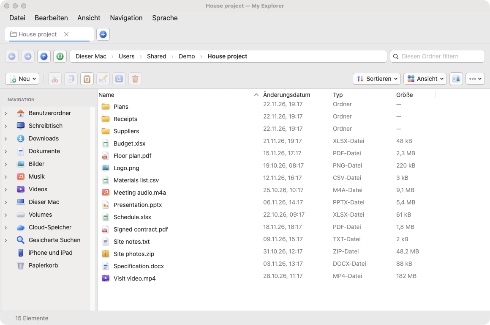

# My Explorer

[English](README.md) · [Português (Brasil)](README.pt-BR.md) · [Español](README.es.md) · [Français](README.fr.md) · [Deutsch](README.de.md) · [日本語](README.ja.md) · [한국어](README.ko.md) · [Italiano](README.it.md)

**My-Suite:** **My Explorer** · [My Notepad](https://github.com/leoars/My-Notepad/blob/main/docs/readme/de.md) · [My Paint](https://github.com/leoars/my-paint/blob/main/docs/readme/de.md)

My Explorer ist ein nativer Dateimanager für macOS. Er verbindet Ordnerbaum, Tabs, Befehlsleiste und mehrere Ansichten mit Papierkorb, Volumes, iCloud und den Apps des Mac.


## Installieren

Öffne die DMG-Datei, kopiere **My Explorer** in den Ordner **Programme**, wirf das Image aus und öffne die App. Die veröffentlichten Versionen sind mit Developer ID signiert und von Apple notarisiert. [Für Mac herunterladen](https://github.com/leoars/my-explorer/releases/latest)

Erfordert macOS 14 oder neuer, auf Apple Silicon oder Intel. Wenn du von einer früheren Version aktualisierst, fragt macOS möglicherweise erneut nach den Datenschutzberechtigungen und nach dem Zugriff auf die Passwörter, die die App im Schlüsselbund gesichert hat.

Um My Explorer, My Notepad und My Paint auf einmal zu installieren, nutze das [Installationsprogramm der My-Suite](https://github.com/leoars/my-suite/blob/main/docs/readme/en.md).

## Funktionen

### Navigation

- Ordnerbaum mit Benutzerordner, Schreibtisch, Dokumente, Downloads, Bilder, Musik, Videos, Dieser Mac, Volumes, Cloud-Speicher, Gesicherte Suchen, iPhone und iPad sowie Papierkorb.
- Tabs, jeder mit eigenem Verlauf, eigener Auswahl, Sortierung und eigenem Filter. Die Taste für einen neuen Tab steht direkt hinter dem letzten Tab.
- Eine einzige Adressleiste: Sie zeigt den anklickbaren Ordnerpfad und wird beim Anklicken zum Pfad als Text, mit Vorschlägen während der Eingabe.
- **Zurück**, **Vorwärts**, **Übergeordneter Ordner** und **Aktualisieren**. Die Liste aktualisiert sich von selbst, wenn sich Dateien außerhalb der App ändern.
- **Diesen Ordner filtern** nach Namen und **Dateien suchen…** nach Name, Erweiterung, Inhalt, Datum und Tags, in diesem Ordner oder auf dem gesamten Mac. Suchen lassen sich im Baum sichern.
- Menüs im Fenster (My Explorer, Datei, Bearbeiten, Ansicht, Navigation, Fenster, Hilfe), zusätzlich zur Menüleiste von macOS.

### Ansichten und Sortierung

- Fünf Modi, die sich die App für jeden Ordner merkt: **Details**, **Liste**, **Kleine Symbole**, **Große Symbole** und **Galerie**.
- In „Große Symbole“ und in der Galerie erscheinen Fotos und Videos als Miniaturen.
- **Sortieren** nach Name, Änderungsdatum, Typ oder Größe, aufsteigend oder absteigend.
- In „Details“ änderst du durch Ziehen der Spaltenköpfe die Reihenfolge oder die Breite der Spalten.
- **Ausgeblendete Elemente** und **Dateinamenerweiterungen** im Menü „Ansicht“.



### Dateioperationen

- Befehlsleiste mit **Neu**, **Ausschneiden**, **Kopieren**, **Einfügen**, **Umbenennen**, **Teilen** und **Löschen**.
- Kopieren und Bewegen mit Fortschritt, Pause und Überprüfung. Wenn der Name bereits vorhanden ist: ersetzen, Ordner zusammenführen, beide behalten oder überspringen.
- **Rückgängig** für bis zu 20 Kopier-, Verschiebe- und Löschvorgänge der Sitzung.
- Umbenennen an Ort und Stelle mit F2 oder mit einem langsamen zweiten Klick auf den Namen.
- Papierkorb im Baum, mit **Zurücklegen**, **Endgültig löschen…** und **Papierkorb entleeren…**.
- **Als ZIP komprimieren** und **ZIP entpacken**.
- Drag & Drop innerhalb der App, in andere Apps und aus ihnen heraus.
- **Eigenschaften** mit Pfad und Zugriffsrechten; bei einem Volume gesamte, belegte und freie Kapazität.
- **Öffnen mit…**, **Teilen…** (auch per AirDrop), **Finder-Tags bearbeiten…** und **Pfad kopieren**.
- Schnellaktionen für Bilder und PDFs: drehen, in JPEG oder PNG konvertieren und PDF erstellen.

### Vorschaubereich und Medienbetrachter

- Der Vorschaubereich zeigt Bilder, Video und Audio mit Wiedergabesteuerung, PDFs zum Blättern und alle übrigen Typen über die Übersicht (Quick Look).
- Der Betrachter öffnet Bilder, Videos und Audiodateien in einem eigenen Fenster, wechselt mit den Pfeiltasten durch die Dateien des Ordners und zoomt von 1 % bis 800 %.
- Animierte Bilder (WebP, GIF, APNG) werden abgespielt.
- Die automatische Wiedergabe von Videos lässt sich in den Optionen ausschalten.

### Texterkennung (OCR)

- **Text extrahieren…** aus Bildern und gescannten PDFs, mit Spracherkennung, zum Kopieren oder Sichern als TXT.
- **Durchsuchbare PDF erstellen…**, für eine einzelne Datei oder im Stapel mit bis zu 50 Dateien.
- Alles geschieht direkt auf dem Mac.

### iCloud

- Status jedes Objekts in iCloud Drive in der Liste: auf dem Mac, nur online, wird geladen oder wird hochgeladen.
- Eine Datei mit einem Klick laden, mit Fortschritt am Symbol, und **Download von diesem Mac entfernen**.
- Den gesamten Inhalt eines Ordners oder nur die Auswahl laden, mit Rückfrage bei vielen Dateien und einer Speicherplatzreserve, die nie unterschritten wird.

### Cloud-Speicher

- Amazon S3: einen Bucket verbinden, durchsuchen, zwischen Mac und Cloud kopieren, bewegen, Ordner anlegen und löschen. Die Zugangsdaten liegen im Schlüsselbund von macOS.
- Azure Blob Storage und Google Cloud Storage sind experimentell.

### Geschützte Ordner

- **Ordner schützen…** legt einen Ordner in einem mit AES-256 verschlüsselten Tresor ab, der sich mit einem Passwort öffnen lässt.
- Automatische Sperre beim Sperren der Sitzung, beim Ruhezustand und beim Beenden.

### Git

- Statusmarkierungen an den Dateien eines lokalen Repositorys und der Branch in der Statusleiste.
- **Änderungen anzeigen** und **Verlauf anzeigen**, Dateien zum Commit vormerken und wieder zurücknehmen, Commit, Branch wechseln, Fetch, Pull und Push, mit dem auf dem Mac installierten Git.

### Volumes und Netzwerk

- Datenträger auswerfen, **Mit Server verbinden…** über SMB und Fotos von einem iPhone oder iPad importieren.

### Optionen und Erscheinungsbild

- Tabs oder den letzten Ordner beim Öffnen wiederherstellen, Löschvorgänge bestätigen, den Baum bis zum geöffneten Ordner aufklappen und Sprache der Oberfläche.
- Getrennte Schriftgrößen für Baum, Liste, Menüs und Leisten. Helles oder dunkles Design, passend zum System.
- Updates: Die App kann beim Öffnen nach neuen Versionen suchen und die Version installieren, der du zustimmst.
- Verfügbar auf Portugiesisch, Englisch, Spanisch, Französisch, Deutsch, Japanisch, Koreanisch und Italienisch, mit sofortigem Wechsel.

### Automatisierung

- Ein Kommandozeilenwerkzeug und ein MCP-Server erlauben einem KI-Assistenten, 24 Stunden lang in den Ordnern zu arbeiten, die du freigibst. Experimentell und standardmäßig ausgeschaltet: **Optionen → Integrationen → KI-Assistenten verbinden**.

## Tastaturkurzbefehle

Die Kurzbefehle mit Strg funktionieren so, wie du sie bereits kennst, auch in Textfeldern; die Entsprechungen mit ⌘ ebenfalls.

| Tasten | Aktion |
| --- | --- |
| Strg+T / Strg+W | Tab öffnen oder schließen |
| Strg+Tab / Strg+Shift+Tab | Nächster oder vorheriger Tab |
| Strg+L | Adresse bearbeiten |
| Strg+F / F3 | Aktuellen Ordner filtern |
| ⇧⌘F | Dateien suchen |
| Strg+X / Strg+C / Strg+V | Ausschneiden, kopieren und einfügen |
| Strg+Z | Letzten Vorgang rückgängig machen |
| Strg+A | Alles auswählen |
| F2 | Umbenennen |
| Del (Fn+⌫) | Auswahl löschen |
| Enter / Backspace | Objekt öffnen oder zurückgehen |
| Option+← / → / ↑ | Zurück, vorwärts oder zum übergeordneten Ordner |
| F5 / Strg+R | Aktualisieren |
| Strg+Shift+N | Neuer Ordner |
| Option+Enter | Eigenschaften |
| Strg++ / Strg+- | Schrift vergrößern oder verkleinern |
| ⌘ , | Optionen |

## Teil der My-Suite

My Explorer gehört zur My-Suite: drei einfache, unkomplizierte Apps für macOS, mit den vertrauten Menüs und Kurzbefehlen.

- **My Explorer** (dieses Repository): Dateimanager.
- **[My Notepad](https://github.com/leoars/My-Notepad/blob/main/docs/readme/de.md)**: einfacher Texteditor. Ist er installiert, öffnet ein Doppelklick auf eine .txt-Datei den Text in My Notepad, und im Kontextmenü erscheint **Mit My Notepad bearbeiten**.
- **[My Paint](https://github.com/leoars/my-paint/blob/main/docs/readme/de.md)**: einfaches Bildbearbeitungsprogramm. Ist es installiert, erscheint im Kontextmenü von Bildern **Mit My Paint bearbeiten**.

## Aus dem Quellcode installieren

Du brauchst einen Mac mit macOS 14 oder neuer und Xcode mit Swift 6. Öffne das Terminal im Ordner mit der Datei `Package.swift` und führe die beiden folgenden Befehle aus. Für eine universelle App für Apple Silicon und Intel setze vor dem Build-Befehl `MY_EXPLORER_ARCHITECTURES='arm64 x86_64'`.

```sh
bash scripts/build-app.sh release
open "dist/My Explorer.app"
```

Zum Installieren beende die App und kopiere `dist/My Explorer.app` in den Ordner „Programme“. Du kannst `Package.swift` auch in Xcode öffnen. Lokale Builds verwenden standardmäßig eine Ad-hoc-Signatur.

## Testen und mitwirken

Führe die Swift-Tests und, in einer entsperrten grafischen Sitzung, die Oberflächentests aus. Wenn du ein Problem meldest, gib die macOS-Version, die Architektur des Mac, die Schritte zum Nachvollziehen und das erwartete Ergebnis an. Verwende Beispieldateien.

```sh
swift test
bash scripts/smoke-test.sh
```

Veröffentlicht unter der [Apache-Lizenz 2.0](LICENSE). Die Nachweise zu den enthaltenen Bibliotheken stehen in den [Drittlizenzhinweisen](THIRD_PARTY_NOTICES.md).
