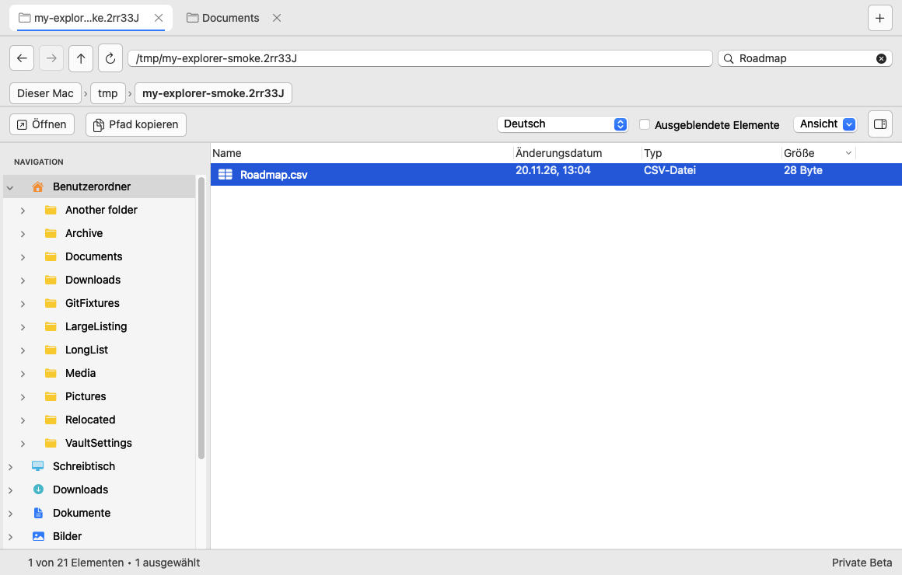

# My Explorer

[English](README.md) · [Português (Brasil)](README.pt-BR.md) · [Español](README.es.md) · [Français](README.fr.md) · [Deutsch](README.de.md) · [日本語](README.ja.md) · [한국어](README.ko.md) · [Italiano](README.it.md)

My Explorer ist ein nativer Dateimanager für macOS. Ordnerbaum, Tabs und Detailansicht orientieren sich am Windows-Explorer. Laufwerke, Papierkorb und die zum Öffnen von Dateien verwendeten Programme stammen von macOS.



## Version 30 installieren

Öffne die DMG-Datei, kopiere **My Explorer** in den Ordner **Programme**, wirf das Image aus und öffne die App. Diese Version ist mit Developer ID signiert und von Apple notarisiert. [Für Mac herunterladen](https://github.com/leoars/my-explorer/releases/latest)

Version 30 ist die erste, die mit Developer ID signiert und von Apple notarisiert ist; macOS öffnet sie daher ohne den zusätzlichen Sicherheitsschritt. Nachdem du die App einmal geöffnet hast, erscheint ihr Symbol im Finder ohne den grauen Rahmen. Wenn du von einer früheren Version aktualisierst, fragt macOS möglicherweise erneut nach den Datenschutzberechtigungen und nach dem Zugriff auf die Passwörter, die die App im Schlüsselbund gesichert hat.

## Kompilieren und installieren

Vorausgesetzt werden macOS 14 oder neuer und Xcode mit Swift 6. Öffne das Terminal im Ordner mit der Datei `Package.swift` und führe die folgenden Befehle aus. Für einen Universal-Build für Apple Silicon und Intel stelle dem Build-Befehl `MY_EXPLORER_ARCHITECTURES='arm64 x86_64'` voran.

```sh
bash scripts/build-app.sh release
open "dist/My Explorer.app"
```

Beende die App und kopiere `dist/My Explorer.app` in den Ordner Programme. Du kannst auch `Package.swift` in Xcode öffnen. Lokale Builds verwenden standardmäßig eine Ad-hoc-Signatur.

## Dateien durchsuchen und verwalten

Wähle ein Laufwerk im Baum oder gib einen Pfad in die Adressleiste ein. Jeder Tab behält seinen Verlauf, seine Sortierung und seine Auswahl. Der Filter sucht nach Namen im geöffneten Ordner. Durch Ziehen der Spaltenköpfe kannst du die Spalten verschieben oder ihre Breite ändern.

Dateien und Ordner lassen sich kopieren, ausschneiden und einfügen. Bei Namenskonflikten kannst du ersetzen, beide behalten oder überspringen. Bis zu 20 lokale Kopier- oder Verschiebevorgänge der Sitzung lassen sich rückgängig machen. Das Kontextmenü bietet Umbenennen, Teilen sowie Erstellen und Entpacken von ZIP-Archiven.

Über **Eigenschaften** im Kontextmenü einer Datei siehst du ihre Details. Bei einem Laufwerk wie Macintosh HD zeigt derselbe Befehl im Baum die Gesamtkapazität sowie den belegten und freien Speicherplatz.

Zum direkten Umbenennen wähle einen Eintrag aus und klicke nach einer kurzen Pause erneut auf seinen Namen. Die Eingabetaste bestätigt, Esc bricht ab. Ein Doppelklick öffnet den Eintrag. F2 und **Umbenennen** öffnen den Dialog.

Während der Sitzung stellen Ctrl+Z oder ⌘Z gelöschte Objekte aus dem Papierkorb im ursprünglichen Ordner wieder her. Bei einem Namenskonflikt kannst du abbrechen und es später erneut versuchen oder beide behalten und einen nummerierten Namen verwenden.

## Mit Git arbeiten

In lokalen Repositorys kennzeichnen Symbole geänderte, neue und ignorierte Dateien sowie Konflikte. Im Untermenü **Git** kannst du für einen Ordner oder ausgewählte Dateien die Änderungen im Index und im Arbeitsverzeichnis getrennt ansehen.


Rufe den Verlauf der Auswahl auf oder nimm Dateien in den Index auf und wieder heraus. Ein Commit umfasst den gesamten Index. Branch-Wechsel, Fetch, Pull und Push verwenden das auf dem Mac installierte Git und verlangen eine Bestätigung im Terminal.

## Vorschau und Texterkennung

Aktiviere die Vorschau und wähle eine lokale Datei, um sie neben der Liste anzusehen. Öffne Bilder, Ton- oder Videodateien im Medienfenster und wechsle mit den Pfeiltasten zwischen ihnen. Mit OCR lässt sich Text aus Bildern und Scans extrahieren oder ein durchsuchbares PDF erstellen.


## Geschützte Ordner und Cloud-Speicher

Wähle im Kontextmenü eines lokalen Ordners **Ordner schützen**. Lege beim ersten Mal ein Hauptpasswort und danach ein Ordnerpasswort fest. Sperre den Ordner für eine Sicherung und kopiere das gesamte Paket mit der Endung `.myexplorervault`. Solange es entsperrt ist, können andere Programme mit deinen Rechten die Dateien lesen.

Unter Cloud-Verbindungen richtest du S3-Buckets, Azure-Blob-Container oder Google-Cloud-Storage-Buckets ein. Zugangsdaten werden im macOS-Schlüsselbund gespeichert. Kopieren ist zwischen Mac und Cloud möglich. Azure und Google Cloud sind experimentell und mit simulierten Diensten getestet.

## Optionen und Updates

Öffne die **Optionen** mit ⌘ , um beim Start Tabs oder den letzten Ordner wiederherzustellen. Das Löschen erfordert standardmäßig eine Bestätigung. Schaltest du sie aus, verschiebt Entf die lokale Auswahl direkt in den Papierkorb. In der Cloud wird das entfernte Objekt gelöscht.

In den Optionen können Sie beim Start nach Updates suchen lassen. Sie können sofort aktualisieren, sich nach sieben Tagen erinnern lassen oder die Version überspringen. **Jetzt prüfen** berücksichtigt auch zurückgestellte und übersprungene Versionen. Der Download beginnt nach Ihrer Bestätigung.

## Tastenkürzel

| ⌨ | Tastenkürzel |
| --- | --- |
| ⌘ L | Adresse bearbeiten |
| ⌘ T / ⌘ W | Tab öffnen oder schließen |
| ⌃ Tab / ⌃ ⇧ Tab | Nächster oder vorheriger Tab |
| ⌘ F / F3 | Aktuellen Ordner filtern |
| F2 | Auswahl umbenennen |
| Del / Fn + ⌫ | Auswahl löschen |
| ⌘ Z / Ctrl+Z | Lokalen Dateivorgang rückgängig machen |

## Lokale Automatisierung

Für die CLI oder einen MCP-Client öffnest du **Optionen → Integrationen → KI-Assistenten verbinden**, aktivierst die Automatisierung und erlaubst die benötigten Aktionen für einen Ordner. Der Zugriff läuft nach 24 Stunden ab. Lass die App geöffnet und importiere die erzeugte Konfiguration aus `mcp.json` in deinen Client.

## Testen und mitwirken

Führe die Swift-Tests und in einer entsperrten grafischen Sitzung die Oberflächentests aus. Nenne in einem Fehlerbericht die macOS-Version, die Architektur, die Schritte zum Nachstellen und das erwartete Ergebnis. Verwende Beispieldateien.

```sh
swift test
bash scripts/smoke-test.sh
```

Veröffentlicht unter der [Apache-Lizenz 2.0](LICENSE). Angaben zu den enthaltenen Bibliotheken stehen in den [Drittlizenzhinweisen](THIRD_PARTY_NOTICES.md).
