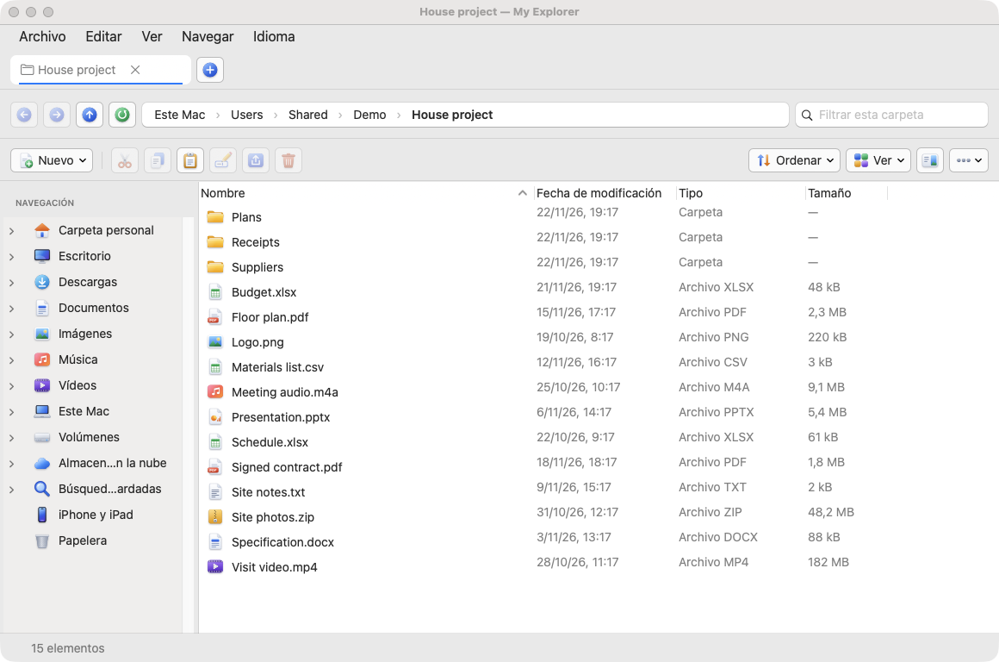

# My Explorer

[English](README.md) · [Português (Brasil)](README.pt-BR.md) · [Español](README.es.md) · [Français](README.fr.md) · [Deutsch](README.de.md) · [日本語](README.ja.md) · [한국어](README.ko.md) · [Italiano](README.it.md)

**Suite My:** **My Explorer** · [My Notepad](https://github.com/leoars/My-Notepad/blob/main/docs/readme/es.md) · [My Paint](https://github.com/leoars/my-paint/blob/main/docs/readme/es.md)

My Explorer es un gestor de archivos nativo para macOS. Reúne árbol de carpetas, pestañas, barra de comandos y varias vistas con la Papelera, los volúmenes, iCloud y las aplicaciones del Mac.


## Instalar

Abre el DMG, copia **My Explorer** en **Aplicaciones**, expulsa la imagen de disco y abre la aplicación. Las versiones publicadas están firmadas con Developer ID y notarizadas por Apple. [Descargar para Mac](https://github.com/leoars/my-explorer/releases/latest)

Requiere macOS 14 o posterior, en Apple Silicon o Intel. Si actualizas desde una versión anterior, macOS puede volver a pedir los permisos de privacidad y el acceso a las contraseñas que la aplicación guardó en Llaveros.

Para instalar My Explorer, My Notepad y My Paint de una vez, usa el [instalador de la suite My](https://github.com/leoars/my-suite/blob/main/docs/readme/en.md).

## Funciones

### Navegación

- Árbol de carpetas con Carpeta personal, Escritorio, Documentos, Descargas, Imágenes, Música, Vídeos, Este Mac, Volúmenes, Almacenamiento en la nube, Búsquedas guardadas, iPhone y iPad y Papelera.
- Pestañas, cada una con su propio historial, selección, orden y filtro. El botón de nueva pestaña queda justo después de la última.
- Una sola barra de direcciones: muestra la ruta de carpetas en la que puedes hacer clic y se convierte en la ruta en texto cuando haces clic en ella, con sugerencias mientras escribes.
- **Atrás**, **Adelante**, **Subir** y **Actualizar**. La lista se actualiza sola cuando los archivos cambian desde fuera.
- **Filtrar esta carpeta** por nombre y **Buscar archivos…** por nombre, extensión, contenido, fecha y etiquetas, en esta carpeta o en todo el Mac. Las búsquedas se pueden guardar en el árbol.
- Menús dentro de la ventana (My Explorer, Archivo, Editar, Ver, Navegar, Ventana, Ayuda), además de la barra de menús de macOS.

### Vistas y ordenación

- Cinco modos, recordados por carpeta: **Detalles**, **Lista**, **Iconos pequeños**, **Iconos grandes** y **Galería**.
- En Iconos grandes y en Galería, las fotos y los vídeos aparecen con miniatura.
- **Ordenar** por nombre, fecha de modificación, tipo o tamaño, en orden ascendente o descendente.
- En Detalles, arrastra las cabeceras para cambiar el orden o el ancho de las columnas.
- **Elementos ocultos** y **Extensiones de nombre de archivo** en el menú Ver.



### Operaciones con archivos

- Barra de comandos con **Nuevo**, **Cortar**, **Copiar**, **Pegar**, **Cambiar nombre**, **Compartir** y **Eliminar**.
- Copiar y mover con progreso, pausa y verificación. Si el nombre ya existe: reemplazar, combinar carpetas, conservar ambos u omitir.
- **Deshacer** para hasta 20 copias, traslados y eliminaciones de la sesión.
- Cambiar el nombre en el propio lugar con F2 o con un segundo clic lento sobre el nombre.
- Papelera en el árbol, con **Restaurar**, **Eliminar definitivamente…** y **Vaciar papelera…**.
- **Comprimir en ZIP** y **Extraer ZIP**.
- Arrastrar y soltar dentro de la aplicación, hacia otras aplicaciones y desde ellas.
- **Propiedades** con ruta y permisos; en un volumen, capacidad total, usada y libre.
- **Abrir con…**, **Compartir…** (también por AirDrop), **Editar etiquetas del Finder…** y **Copiar ruta**.
- Acciones rápidas para imágenes y PDF: girar, convertir a JPEG o PNG y crear un PDF.

### Panel de vista previa y visor multimedia

- El panel de vista previa muestra imágenes, vídeo y audio con controles de reproducción, PDF con paso de páginas y los demás tipos mediante Vista Rápida (Quick Look).
- El visor abre imágenes, vídeos y audio en una ventana propia, avanza por los archivos de la carpeta con las flechas y permite un zoom del 1 % al 800 %.
- Las imágenes animadas (WebP, GIF, APNG) se reproducen.
- La reproducción automática de vídeos se puede desactivar en Opciones.

### Reconocimiento de texto (OCR)

- **Extraer texto…** de imágenes y PDF escaneados, con detección del idioma, para copiarlo o guardarlo como TXT.
- **Crear PDF con búsqueda…**, de archivo en archivo o por lotes de hasta 50.
- Todo se hace en el propio Mac.

### iCloud

- Estado de cada elemento de iCloud Drive en la lista: en el Mac, solo en línea, descargándose o subiéndose.
- Descargar un archivo con un clic, con el progreso en el icono, y **Eliminar descarga de este Mac**.
- Descargar todo el contenido de una carpeta o solo la selección, con confirmación cuando son muchos archivos y una reserva de espacio en disco que nunca se sobrepasa.

### Almacenamiento en la nube

- Amazon S3: conectar un bucket, navegar, copiar entre el Mac y la nube, mover, crear carpetas y eliminar. Las credenciales se guardan en Llaveros de macOS.
- Azure Blob Storage y Google Cloud Storage son experimentales.

### Carpetas protegidas

- **Proteger carpeta…** guarda una carpeta en una bóveda cifrada con AES-256 que se abre con contraseña.
- Bloqueo automático al bloquear la sesión, al entrar en reposo y al salir.

### Git

- Marcas de estado en los archivos de un repositorio local y la rama en la barra de estado.
- **Ver cambios** y **Ver historial**, preparar y retirar archivos, commit, cambiar de rama, fetch, pull y push, con el Git instalado en el Mac.

### Volúmenes y red

- Expulsar discos, **Conectar al servidor…** por SMB e importar fotos de un iPhone o iPad.

### Opciones y apariencia

- Restaurar las pestañas o la última carpeta al abrir, confirmar las eliminaciones, expandir el árbol hasta la carpeta abierta e idioma de la interfaz.
- Tamaños de letra independientes para el árbol, la lista, los menús y las barras. Tema claro u oscuro, según el sistema.
- Actualizaciones: la aplicación puede buscar nuevas versiones al abrirse e instalar la que aceptes.
- Disponible en portugués, inglés, español, francés, alemán, japonés, coreano e italiano, con cambio inmediato.

### Automatización

- Una línea de comandos y un servidor MCP permiten que un asistente de IA trabaje en las carpetas que autorices, durante 24 horas. Experimental y desactivado por defecto: **Opciones → Integraciones → Conectar un asistente de IA**.

## Atajos

Los atajos con Ctrl funcionan como ya los conoces, también en los campos de texto; sus equivalentes con ⌘ también.

| Teclas | Acción |
| --- | --- |
| Ctrl+T / Ctrl+W | Abrir o cerrar una pestaña |
| Ctrl+Tab / Ctrl+Shift+Tab | Pestaña siguiente o anterior |
| Ctrl+L | Editar la dirección |
| Ctrl+F / F3 | Filtrar la carpeta actual |
| ⇧⌘F | Buscar archivos |
| Ctrl+X / Ctrl+C / Ctrl+V | Cortar, copiar y pegar |
| Ctrl+Z | Deshacer la última operación |
| Ctrl+A | Seleccionar todo |
| F2 | Cambiar nombre |
| Del (Fn+⌫) | Eliminar la selección |
| Enter / Backspace | Abrir el elemento o volver atrás |
| Option+← / → / ↑ | Atrás, adelante o subir |
| F5 / Ctrl+R | Actualizar |
| Ctrl+Shift+N | Nueva carpeta |
| Option+Enter | Propiedades |
| Ctrl++ / Ctrl+- | Aumentar o reducir el tamaño de letra |
| ⌘ , | Opciones |

## Parte de la suite My

My Explorer forma parte de la suite My: tres aplicaciones para macOS sencillas y directas, con los menús y los atajos de siempre.

- **My Explorer** (este repositorio): gestor de archivos.
- **[My Notepad](https://github.com/leoars/My-Notepad/blob/main/docs/readme/es.md)**: editor de texto sencillo. Con él instalado, el doble clic en un archivo .txt abre el texto en My Notepad, y el menú contextual incorpora **Editar con My Notepad**.
- **[My Paint](https://github.com/leoars/my-paint/blob/main/docs/readme/es.md)**: editor de imágenes sencillo. Con él instalado, el menú contextual de las imágenes incorpora **Editar con My Paint**.

## Instalar desde el código fuente

Necesitas un Mac con macOS 14 o posterior y Xcode con Swift 6. Abre Terminal en la carpeta que contiene `Package.swift` y ejecuta los dos comandos siguientes. Para generar una aplicación universal para Apple Silicon e Intel, define `MY_EXPLORER_ARCHITECTURES='arm64 x86_64'` antes del comando de compilación.

```sh
bash scripts/build-app.sh release
open "dist/My Explorer.app"
```

Para instalarla, cierra la aplicación y copia `dist/My Explorer.app` en Aplicaciones. También puedes abrir `Package.swift` en Xcode. La compilación local usa firma ad hoc por defecto.

## Probar y contribuir

Ejecuta las pruebas de Swift y, en una sesión gráfica desbloqueada, las pruebas de interfaz. Para informar de un problema, indica la versión de macOS, la arquitectura del Mac, los pasos para reproducirlo y el resultado esperado. Usa archivos de ejemplo.

```sh
swift test
bash scripts/smoke-test.sh
```

Distribuido bajo la [licencia Apache 2.0](LICENSE). Las atribuciones de las bibliotecas incluidas están en los [avisos de terceros](THIRD_PARTY_NOTICES.md).
