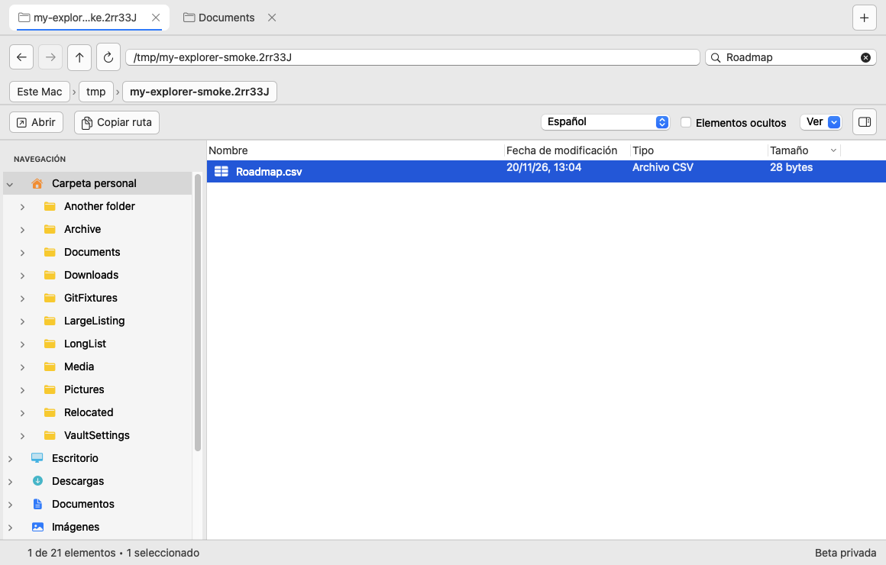
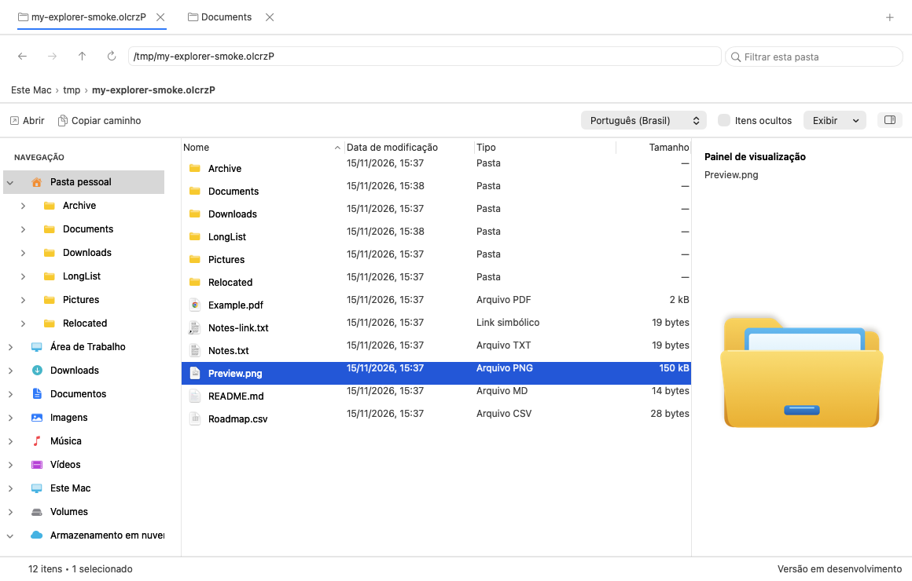

# My Explorer

[English](README.md) · [Português (Brasil)](README.pt-BR.md) · [Español](README.es.md) · [Français](README.fr.md) · [Deutsch](README.de.md) · [日本語](README.ja.md) · [한국어](README.ko.md) · [Italiano](README.it.md)

My Explorer es un gestor de archivos nativo para macOS. Combina el árbol de carpetas, las pestañas y la vista de detalles del Explorador de archivos de Windows con los volúmenes, la Papelera y las aplicaciones del Mac.



## Instalar la aplicación firmada

Abre el DMG de la versión preliminar, copia **My Explorer** a **Aplicaciones**, expulsa la imagen y abre la aplicación. La versión 27 tiene firma Apple Development y no está notarizada. [GitHub Releases](https://github.com/leoars/my-explorer/releases/tag/v0.1.0-private-beta.12-build27)

## Compilar e instalar

Necesitas macOS 14 o posterior y Xcode con Swift 6. Abre Terminal en la carpeta que contiene `Package.swift` y ejecuta estos comandos. Para compilar para Apple Silicon e Intel, añade `MY_EXPLORER_ARCHITECTURES='arm64 x86_64'` delante del comando de compilación.

```sh
bash scripts/build-app.sh release
open "dist/My Explorer.app"
```

Para instalarlo, cierra la aplicación y copia `dist/My Explorer.app` a Aplicaciones. También puedes abrir `Package.swift` en Xcode. Las compilaciones locales usan firma ad hoc por defecto.

## Explorar y organizar archivos

Selecciona un volumen en el árbol o escribe una ruta en la barra de direcciones. Cada pestaña conserva su historial, orden y selección. El filtro busca nombres dentro de la carpeta abierta. Arrastra las cabeceras para mover o ajustar las columnas.

Copia, corta y pega archivos o carpetas. Si el nombre ya existe, puedes reemplazar el elemento, conservar ambos u omitirlo. Deshacer admite hasta 20 operaciones locales de copia o traslado de la sesión. El menú contextual permite renombrar, compartir, crear archivos ZIP y extraerlos.

Haz clic derecho en un archivo y selecciona **Propiedades** para ver sus detalles. En un volumen del árbol, como Macintosh HD, esta acción muestra la capacidad total y el espacio utilizado y libre.

Para cambiar el nombre en la lista, selecciona el elemento, espera un momento y vuelve a hacer clic en su nombre. Intro confirma y Esc cancela. Un doble clic abre el elemento. F2 y el comando de cambio de nombre abren el cuadro de diálogo.

Durante la sesión actual, Ctrl+Z o ⌘Z restaura los elementos de la Papelera en su carpeta de origen. Si el nombre está ocupado, cancela para volver a intentarlo o conserva ambos con un nombre numerado.

## Trabajar con Git

En un repositorio local, los indicadores distinguen los archivos modificados, nuevos, ignorados y en conflicto. En **Git → Ver cambios**, consulta por separado los cambios preparados y los del árbol de trabajo para la carpeta o los archivos seleccionados.


Consulta el historial de la selección y añade o retira archivos del índice. El commit incluye todo el índice. El cambio de rama, fetch, pull y push utilizan el Git del Mac y solicitan confirmación en Terminal.

## Vista previa y reconocimiento de texto

Activa el panel de vista previa y selecciona un archivo local para verlo junto a la lista. Abre imágenes, audio o vídeo en el visor y navega con las flechas. Las herramientas OCR permiten extraer texto de imágenes y documentos escaneados y crear PDF con búsqueda.



## Carpetas protegidas y almacenamiento en la nube

Elige **Proteger carpeta** en el menú de una carpeta local. La primera vez, crea una contraseña maestra y otra para la carpeta. Para una copia de seguridad, bloquea la carpeta y copia el paquete `.myexplorervault` completo. Mientras esté desbloqueada, otras aplicaciones con tus permisos pueden acceder a los archivos.

En las conexiones en la nube puedes configurar un bucket de S3 o Google Cloud Storage o un contenedor de Azure Blob. Las credenciales se guardan en el llavero de macOS. Puedes copiar entre el Mac y la nube. Azure y Google Cloud siguen siendo experimentales y se prueban con proveedores simulados.

## Opciones y actualizaciones

Abre **Opciones** con ⌘ , para restaurar las pestañas o la última carpeta al iniciar. La confirmación de borrado está activada por defecto. Al desactivarla, Supr envía la selección local directamente a la Papelera. En la nube se elimina el objeto remoto.

En **Opciones** puedes buscar actualizaciones al iniciar. Si hay una, puedes actualizar ahora, aplazar siete días u omitir la versión. **Comprobar ahora** también busca versiones aplazadas u omitidas. La descarga comienza tras tu confirmación.

## Atajos de teclado

| ⌨ | Atajos de teclado |
| --- | --- |
| ⌘ L | Editar la dirección |
| ⌘ T / ⌘ W | Abrir o cerrar una pestaña |
| ⌃ Tab / ⌃ ⇧ Tab | Pestaña siguiente o anterior |
| ⌘ F / F3 | Filtrar la carpeta actual |
| F2 | Cambiar el nombre |
| Del / Fn + ⌫ | Eliminar la selección |
| ⌘ Z / Ctrl+Z | Deshacer una operación local |

## Automatización local

Para usar la CLI o un cliente MCP, abre el acceso de IA en el menú Ver, activa la automatización y concede los permisos necesarios sobre una carpeta. El acceso caduca en 24 horas. Mantén la aplicación abierta e importa la configuración de `mcp.json` en el cliente.

## Pruebas y contribuciones

Ejecuta las pruebas de Swift y, con una sesión gráfica desbloqueada, las pruebas de interfaz. Al comunicar un fallo, indica la versión de macOS, la arquitectura, los pasos para reproducirlo y el resultado esperado. Utiliza archivos de ejemplo.

```sh
swift test
bash scripts/smoke-test.sh
```

Distribuido con la [licencia Apache 2.0](LICENSE). Consulta los [avisos de terceros](THIRD_PARTY_NOTICES.md) de las bibliotecas incluidas.
