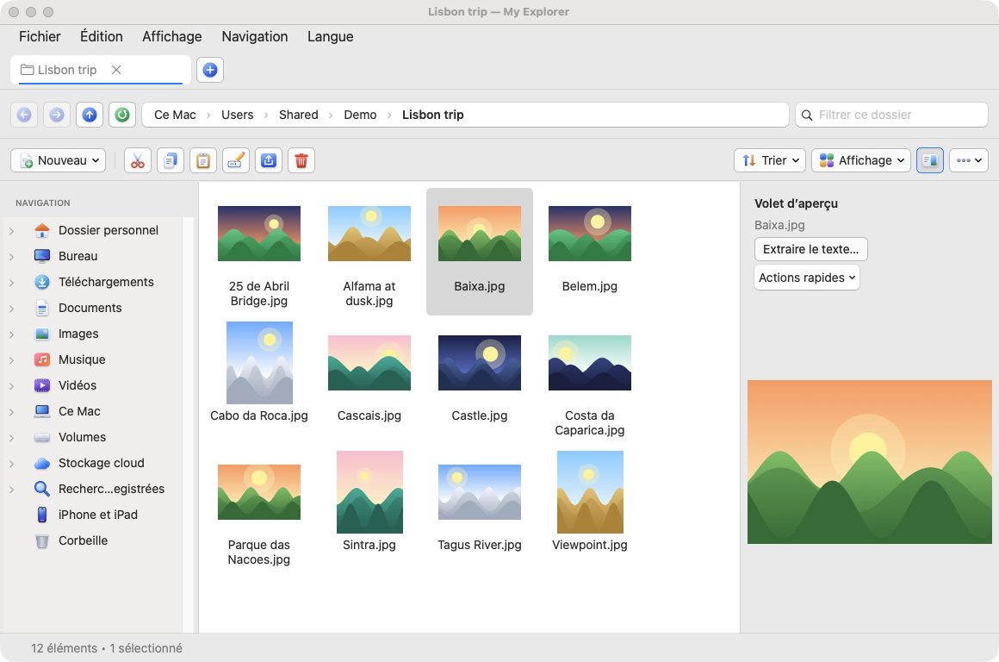
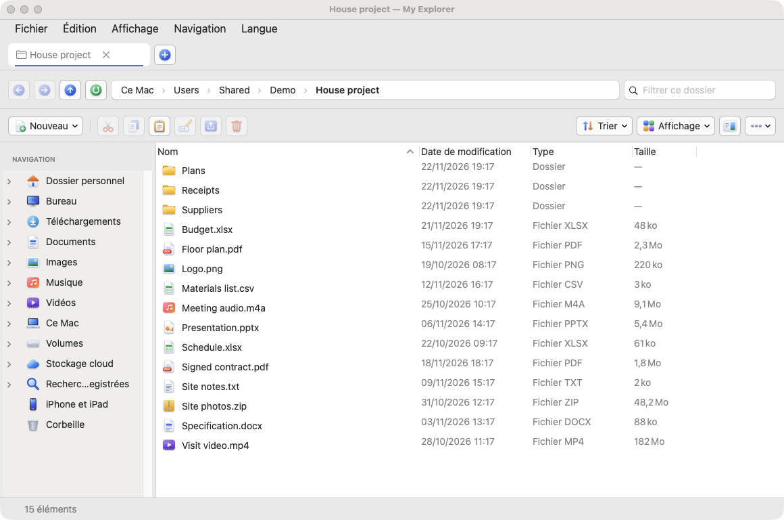

# My Explorer

[English](README.md) · [Português (Brasil)](README.pt-BR.md) · [Español](README.es.md) · [Français](README.fr.md) · [Deutsch](README.de.md) · [日本語](README.ja.md) · [한국어](README.ko.md) · [Italiano](README.it.md)

**Suite My:** **My Explorer** · [My Notepad](https://github.com/leoars/My-Notepad/blob/main/docs/readme/fr.md) · [My Paint](https://github.com/leoars/my-paint/blob/main/docs/readme/fr.md)

My Explorer est un gestionnaire de fichiers natif pour macOS. Il réunit une arborescence de dossiers, des onglets, une barre de commandes et plusieurs modes d’affichage avec la Corbeille, les volumes, iCloud et les applications du Mac.



## Installer

Ouvrez le DMG, copiez **My Explorer** dans **Applications**, éjectez l’image disque et ouvrez l’application. Les versions publiées sont signées avec Developer ID et notariées par Apple. [Télécharger pour Mac](https://github.com/leoars/my-explorer/releases/latest)

Nécessite macOS 14 ou ultérieur, sur Apple Silicon ou Intel. Si vous effectuez une mise à jour depuis une version antérieure, macOS peut redemander les autorisations de confidentialité et l’accès aux mots de passe que l’application a enregistrés dans Trousseaux d’accès.

## Fonctionnalités

### Navigation

- Arborescence des dossiers avec Dossier personnel, Bureau, Documents, Téléchargements, Images, Musique, Vidéos, Ce Mac, Volumes, Stockage cloud, Recherches enregistrées, iPhone et iPad et Corbeille.
- Des onglets, chacun avec son historique, sa sélection, son tri et son filtre. Le bouton de nouvel onglet se trouve juste après le dernier.
- Une seule barre d’adresse : elle affiche le fil des dossiers, cliquable, et se transforme en chemin au format texte quand vous cliquez dessus, avec des suggestions pendant la saisie.
- **Précédent**, **Suivant**, **Dossier parent** et **Actualiser**. La liste s’actualise d’elle-même quand les fichiers changent en dehors de l’application.
- **Filtrer ce dossier** par nom, et **Rechercher des fichiers…** par nom, extension, contenu, date et étiquettes, dans ce dossier ou sur tout le Mac. Les recherches peuvent être enregistrées dans l’arborescence.
- Des menus dans la fenêtre (Fichier, Édition, Affichage, Navigation, Langue), en plus de la barre des menus de macOS.

### Affichages et tri

- Cinq modes, mémorisés pour chaque dossier : **Détails**, **Liste**, **Petites icônes**, **Grandes icônes** et **Galerie**.
- En Grandes icônes et en Galerie, les photos et les vidéos s’affichent sous forme de vignettes.
- **Trier** par nom, date de modification, type ou taille, par ordre croissant ou décroissant.
- En Détails, faites glisser les en-têtes pour modifier l’ordre ou la largeur des colonnes.
- **Éléments masqués** et **Extensions de noms de fichiers** dans le menu Affichage.



### Opérations sur les fichiers

- Barre de commandes avec **Nouveau**, **Couper**, **Copier**, **Coller**, **Renommer**, **Partager** et **Supprimer**.
- Copie et déplacement avec progression, pause et vérification. Si le nom existe déjà : remplacer, fusionner les dossiers, conserver les deux ou ignorer.
- **Annuler** pour un maximum de 20 copies, déplacements et suppressions de la session.
- Renommage sur place avec F2 ou par un second clic lent sur le nom.
- Corbeille dans l’arborescence, avec **Remettre**, **Supprimer définitivement…** et **Vider la corbeille…**.
- **Compresser en ZIP** et **Extraire le ZIP**.
- Glisser-déposer dans l’application, vers d’autres applications et depuis celles-ci.
- **Propriétés** avec le chemin et les autorisations ; pour un volume, capacité totale, utilisée et libre.
- **Ouvrir avec…**, **Partager…** (y compris par AirDrop), **Modifier les étiquettes du Finder…** et **Copier le chemin**.
- Actions rapides pour les images et les PDF : faire pivoter, convertir en JPEG ou PNG et créer un PDF.

### Volet d’aperçu et visionneuse multimédia

- Le volet d’aperçu affiche les images, la vidéo et l’audio avec des commandes de lecture, les PDF avec le défilement des pages et les autres types grâce à Coup d’œil (Quick Look).
- La visionneuse ouvre les images, les vidéos et les fichiers audio dans une fenêtre à part, passe d’un fichier du dossier à l’autre avec les flèches et zoome de 1 % à 800 %.
- Les images animées (WebP, GIF, APNG) sont lues.
- La lecture automatique des vidéos peut être désactivée dans Options.

### Reconnaissance de texte (OCR)

- **Extraire le texte…** des images et des PDF numérisés, avec détection de la langue, pour le copier ou l’enregistrer au format TXT.
- **Créer un PDF consultable…**, un fichier à la fois ou par lot de 50 au maximum.
- Tout est traité sur le Mac lui-même.

### iCloud

- État de chaque élément d’iCloud Drive dans la liste : sur le Mac, en ligne uniquement, en cours de téléchargement ou d’envoi.
- Téléchargement d’un fichier en un clic, avec la progression sur l’icône, et **Supprimer le téléchargement de ce Mac**.
- Téléchargement de tout un dossier ou de la seule sélection, avec confirmation lorsque les fichiers sont nombreux et une réserve d’espace disque qui n’est jamais entamée.

### Stockage cloud

- Amazon S3 : connecter un bucket, parcourir, copier entre le Mac et le cloud, déplacer, créer des dossiers et supprimer. Les identifiants sont conservés dans Trousseaux d’accès de macOS.
- Azure Blob Storage et Google Cloud Storage sont expérimentaux.

### Dossiers protégés

- **Protéger le dossier…** place un dossier dans un coffre chiffré en AES-256, ouvert par mot de passe.
- Verrouillage automatique au verrouillage de la session, à la mise en veille et à la fermeture de l’application.

### Git

- Marques d’état sur les fichiers d’un dépôt local et branche dans la barre d’état.
- **Voir les modifications** et **Voir l’historique**, indexer et désindexer des fichiers, commit, changement de branche, fetch, pull et push, avec le Git installé sur le Mac.

### Volumes et réseau

- Éjecter des disques, **Se connecter au serveur…** en SMB et importer les photos d’un iPhone ou d’un iPad.

### Options et apparence

- Restaurer les onglets ou le dernier dossier à l’ouverture, confirmer les suppressions, développer l’arborescence jusqu’au dossier ouvert et langue de l’interface.
- Tailles de police distinctes pour l’arborescence, la liste, les menus et les barres. Thème clair ou sombre, selon le système.
- Mises à jour : l’application peut rechercher les nouvelles versions à l’ouverture et installer celle que vous acceptez.
- Disponible en portugais, anglais, espagnol, français, allemand, japonais, coréen et italien, avec changement immédiat.

### Automatisation

- Une ligne de commande et un serveur MCP permettent à un assistant IA de travailler dans les dossiers que vous autorisez, pendant 24 heures. Expérimental et désactivé par défaut : **Options → Intégrations → Connecter un assistant IA**.

## Raccourcis

Les raccourcis avec Ctrl fonctionnent comme vous les connaissez déjà, y compris dans les champs de texte ; leurs équivalents avec ⌘ aussi.

| Touches | Action |
| --- | --- |
| Ctrl+T / Ctrl+W | Ouvrir ou fermer un onglet |
| Ctrl+Tab / Ctrl+Shift+Tab | Onglet suivant ou précédent |
| Ctrl+L | Modifier l’adresse |
| Ctrl+F / F3 | Filtrer le dossier actuel |
| ⇧⌘F | Rechercher des fichiers |
| Ctrl+X / Ctrl+C / Ctrl+V | Couper, copier et coller |
| Ctrl+Z | Annuler la dernière opération |
| Ctrl+A | Tout sélectionner |
| F2 | Renommer |
| Del (Fn+⌫) | Supprimer la sélection |
| Enter / Backspace | Ouvrir l’élément ou revenir en arrière |
| Option+← / → / ↑ | Précédent, suivant ou dossier parent |
| F5 / Ctrl+R | Actualiser |
| Ctrl+Shift+N | Nouveau dossier |
| Option+Enter | Propriétés |
| Ctrl++ / Ctrl+- | Agrandir ou réduire les polices |
| ⌘ , | Options |

## Un élément de la suite My

My Explorer fait partie de la suite My : trois applications pour macOS simples et directes, avec les menus et les raccourcis de toujours.

- **My Explorer** (ce dépôt) : gestionnaire de fichiers.
- **[My Notepad](https://github.com/leoars/My-Notepad/blob/main/docs/readme/fr.md)** : éditeur de texte simple. Une fois installé, un double-clic sur un fichier .txt ouvre le texte dans My Notepad, et le menu contextuel s’enrichit de **Modifier avec My Notepad**.
- **[My Paint](https://github.com/leoars/my-paint/blob/main/docs/readme/fr.md)** : éditeur d’images simple. Une fois installé, le menu contextuel des images s’enrichit de **Modifier avec My Paint**.

## Installer à partir du code source

Il faut un Mac avec macOS 14 ou ultérieur et Xcode avec Swift 6. Ouvrez Terminal dans le dossier contenant `Package.swift` et exécutez les deux commandes ci-dessous. Pour produire une application universelle pour Apple Silicon et Intel, définissez `MY_EXPLORER_ARCHITECTURES='arm64 x86_64'` avant la commande de compilation.

```sh
bash scripts/build-app.sh release
open "dist/My Explorer.app"
```

Pour l’installer, quittez l’application et copiez `dist/My Explorer.app` dans Applications. Vous pouvez aussi ouvrir `Package.swift` dans Xcode. Par défaut, la compilation locale utilise une signature ad hoc.

## Tester et contribuer

Exécutez les tests Swift et, dans une session graphique déverrouillée, les tests d’interface. Pour signaler un problème, indiquez la version de macOS, l’architecture du Mac, les étapes pour le reproduire et le résultat attendu. Utilisez des fichiers d’exemple.

```sh
swift test
bash scripts/smoke-test.sh
```

Distribué sous [licence Apache 2.0](LICENSE). Les attributions des bibliothèques incluses figurent dans les [mentions relatives aux tiers](THIRD_PARTY_NOTICES.md).
