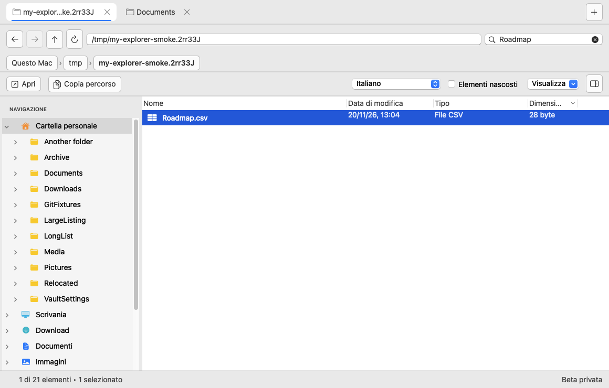
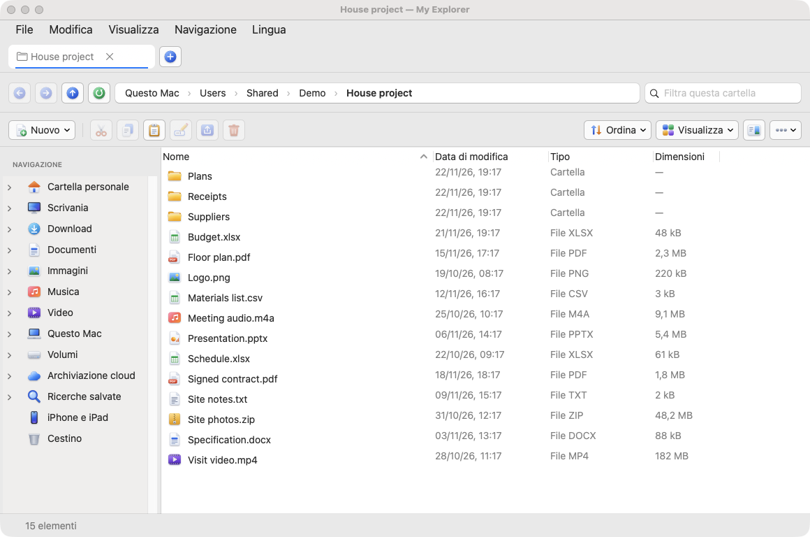

# My Explorer

[English](README.md) · [Português (Brasil)](README.pt-BR.md) · [Español](README.es.md) · [Français](README.fr.md) · [Deutsch](README.de.md) · [日本語](README.ja.md) · [한국어](README.ko.md) · [Italiano](README.it.md)

**Suite My:** **My Explorer** · [My Notepad](https://github.com/leoars/My-Notepad/blob/main/docs/readme/it.md) · [My Paint](https://github.com/leoars/my-paint/blob/main/docs/readme/it.md)

My Explorer è un gestore di file nativo per macOS. Unisce albero delle cartelle, schede, barra dei comandi e diverse viste al Cestino, ai volumi, a iCloud e alle applicazioni del Mac.



## Installare

Apri il DMG, copia **My Explorer** in **Applicazioni**, espelli l’immagine disco e apri l’app. Le versioni pubblicate sono firmate con Developer ID e autenticate da Apple tramite notarizzazione. [Scarica per Mac](https://github.com/leoars/my-explorer/releases/latest)

Richiede macOS 14 o successivo, su Apple Silicon o Intel. Se aggiorni da una versione precedente, macOS potrebbe chiedere di nuovo i permessi di privacy e l’accesso alle password che l’app ha salvato nel Portachiavi.

Per installare My Explorer, My Notepad e My Paint in una volta sola, usa il [programma di installazione della suite My](https://github.com/leoars/my-suite/blob/main/docs/readme/en.md).

## Funzionalità

### Navigazione

- Albero delle cartelle con Cartella personale, Scrivania, Documenti, Download, Immagini, Musica, Video, Questo Mac, Volumi, Archiviazione cloud, Ricerche salvate, iPhone e iPad e Cestino.
- Schede, ciascuna con cronologia, selezione, ordinamento e filtro propri. Il pulsante per una nuova scheda si trova subito dopo l’ultima.
- Una sola barra degli indirizzi: mostra il percorso delle cartelle su cui puoi fare clic e diventa il percorso in formato testo quando ci fai clic, con suggerimenti mentre scrivi.
- **Indietro**, **Avanti**, **Cartella superiore** e **Aggiorna**. L’elenco si aggiorna da solo quando i file cambiano dall’esterno.
- **Filtra questa cartella** per nome e **Cerca file…** per nome, estensione, contenuto, data e tag, in questa cartella o in tutto il Mac. Le ricerche si possono salvare nell’albero.
- Menu all’interno della finestra (File, Modifica, Visualizza, Navigazione, Lingua), oltre alla barra dei menu di macOS.

### Viste e ordinamento

- Cinque modalità, ricordate per ogni cartella: **Dettagli**, **Elenco**, **Icone piccole**, **Icone grandi** e **Galleria**.
- In Icone grandi e nella Galleria, foto e video compaiono con la miniatura.
- **Ordina** per nome, data di modifica, tipo o dimensioni, in ordine crescente o decrescente.
- In Dettagli, trascina le intestazioni per cambiare l’ordine o la larghezza delle colonne.
- **Elementi nascosti** ed **Estensioni nomi file** nel menu Visualizza.



### Operazioni sui file

- Barra dei comandi con **Nuovo**, **Taglia**, **Copia**, **Incolla**, **Rinomina**, **Condividi** ed **Elimina**.
- Copia e spostamento con avanzamento, pausa e verifica. Se il nome esiste già: sostituire, unire le cartelle, conservare entrambi o ignorare.
- **Annulla** per un massimo di 20 copie, spostamenti ed eliminazioni della sessione.
- Rinomina sul posto con F2 o con un secondo clic lento sul nome.
- Cestino nell’albero, con **Ripristina**, **Elimina definitivamente…** e **Svuota cestino…**.
- **Comprimi in ZIP** ed **Estrai ZIP**.
- Trascinamento all’interno dell’app, verso altre applicazioni e da esse.
- **Proprietà** con percorso e permessi; su un volume, capacità totale, utilizzata e libera.
- **Apri con…**, **Condividi…** (anche tramite AirDrop), **Modifica tag del Finder…** e **Copia percorso**.
- Azioni rapide per immagini e PDF: ruotare, convertire in JPEG o PNG e creare un PDF.

### Riquadro di anteprima e visualizzatore multimediale

- Il riquadro di anteprima mostra immagini, video e audio con i controlli di riproduzione, i PDF con lo scorrimento delle pagine e gli altri tipi tramite Visualizzazione rapida (Quick Look).
- Il visualizzatore apre immagini, video e audio in una finestra dedicata, scorre i file della cartella con le frecce e ingrandisce dall’1% all’800%.
- Le immagini animate (WebP, GIF, APNG) vengono riprodotte.
- La riproduzione automatica dei video si può disattivare in Opzioni.

### Riconoscimento del testo (OCR)

- **Estrai testo…** da immagini e PDF acquisiti da scanner, con rilevamento della lingua, per copiarlo o salvarlo come TXT.
- **Crea PDF ricercabile…**, un file alla volta o in blocco fino a 50.
- Tutto avviene sul Mac stesso.

### iCloud

- Stato di ogni elemento di iCloud Drive nell’elenco: sul Mac, solo online, in scaricamento o in caricamento.
- Scaricare un file con un clic, con l’avanzamento sull’icona, e **Rimuovi il download da questo Mac**.
- Scaricare tutto il contenuto di una cartella o solo la selezione, con conferma quando i file sono molti e una riserva di spazio su disco che non viene mai intaccata.

### Archiviazione cloud

- Amazon S3: collegare un bucket, sfogliare, copiare tra il Mac e il cloud, spostare, creare cartelle ed eliminare. Le credenziali restano nel Portachiavi di macOS.
- Azure Blob Storage e Google Cloud Storage sono sperimentali.

### Cartelle protette

- **Proteggi cartella…** custodisce una cartella in una cassaforte cifrata con AES-256, che si apre con una password.
- Blocco automatico quando la sessione viene bloccata, quando il Mac va in stop e all’uscita.

### Git

- Indicatori di stato sui file di un repository locale e il branch nella barra di stato.
- **Visualizza modifiche** e **Visualizza cronologia**, aggiungere e togliere file dall’area di staging, commit, cambio di branch, fetch, pull e push, con il Git installato sul Mac.

### Volumi e rete

- Espellere i dischi, **Connetti al server…** tramite SMB e importare foto da un iPhone o iPad.

### Opzioni e aspetto

- Ripristinare le schede o l’ultima cartella all’apertura, confermare le eliminazioni, espandere l’albero fino alla cartella aperta e lingua dell’interfaccia.
- Dimensioni dei caratteri separate per l’albero, l’elenco, i menu e le barre. Tema chiaro o scuro, in base al sistema.
- Aggiornamenti: l’app può cercare nuove versioni all’apertura e installare quella che accetti.
- Disponibile in portoghese, inglese, spagnolo, francese, tedesco, giapponese, coreano e italiano, con cambio immediato.

### Automazione

- Una riga di comando e un server MCP permettono a un assistente IA di lavorare nelle cartelle che autorizzi, per 24 ore. Sperimentale e disattivato per impostazione predefinita: **Opzioni → Integrazioni → Collega un assistente IA**.

## Scorciatoie

Le scorciatoie con Ctrl funzionano come già le conosci, anche nei campi di testo; lo stesso vale per le equivalenti con ⌘.

| Tasti | Azione |
| --- | --- |
| Ctrl+T / Ctrl+W | Aprire o chiudere una scheda |
| Ctrl+Tab / Ctrl+Shift+Tab | Scheda successiva o precedente |
| Ctrl+L | Modificare l’indirizzo |
| Ctrl+F / F3 | Filtrare la cartella corrente |
| ⇧⌘F | Cercare file |
| Ctrl+X / Ctrl+C / Ctrl+V | Tagliare, copiare e incollare |
| Ctrl+Z | Annullare l’ultima operazione |
| Ctrl+A | Selezionare tutto |
| F2 | Rinominare |
| Del (Fn+⌫) | Eliminare la selezione |
| Enter / Backspace | Aprire l’elemento o tornare indietro |
| Option+← / → / ↑ | Indietro, avanti o cartella superiore |
| F5 / Ctrl+R | Aggiornare |
| Ctrl+Shift+N | Nuova cartella |
| Option+Enter | Proprietà |
| Ctrl++ / Ctrl+- | Aumentare o ridurre i caratteri |
| ⌘ , | Opzioni |

## Parte della suite My

My Explorer fa parte della suite My: tre applicazioni per macOS semplici e dirette, con i menu e le scorciatoie di sempre.

- **My Explorer** (questo repository): gestore di file.
- **[My Notepad](https://github.com/leoars/My-Notepad/blob/main/docs/readme/it.md)**: editor di testo semplice. Quando è installato, il doppio clic su un file .txt apre il testo in My Notepad e il menu contestuale si arricchisce di **Modifica con My Notepad**.
- **[My Paint](https://github.com/leoars/my-paint/blob/main/docs/readme/it.md)**: editor di immagini semplice. Quando è installato, il menu contestuale delle immagini si arricchisce di **Modifica con My Paint**.

## Installare dal codice sorgente

Serve un Mac con macOS 14 o successivo e Xcode con Swift 6. Apri Terminale nella cartella che contiene `Package.swift` ed esegui i due comandi seguenti. Per generare un’app universale per Apple Silicon e Intel, imposta `MY_EXPLORER_ARCHITECTURES='arm64 x86_64'` prima del comando di compilazione.

```sh
bash scripts/build-app.sh release
open "dist/My Explorer.app"
```

Per installare l’app, chiudila e copia `dist/My Explorer.app` in Applicazioni. Puoi anche aprire `Package.swift` in Xcode. La build locale usa una firma ad hoc per impostazione predefinita.

## Testare e contribuire

Esegui i test Swift e, in una sessione grafica sbloccata, i test dell’interfaccia. Per segnalare un problema, indica la versione di macOS, l’architettura del Mac, i passaggi per riprodurlo e il risultato atteso. Usa file di esempio.

```sh
swift test
bash scripts/smoke-test.sh
```

Distribuito con [licenza Apache 2.0](LICENSE). Le attribuzioni delle librerie incluse si trovano nelle [note sulle licenze di terze parti](THIRD_PARTY_NOTICES.md).
