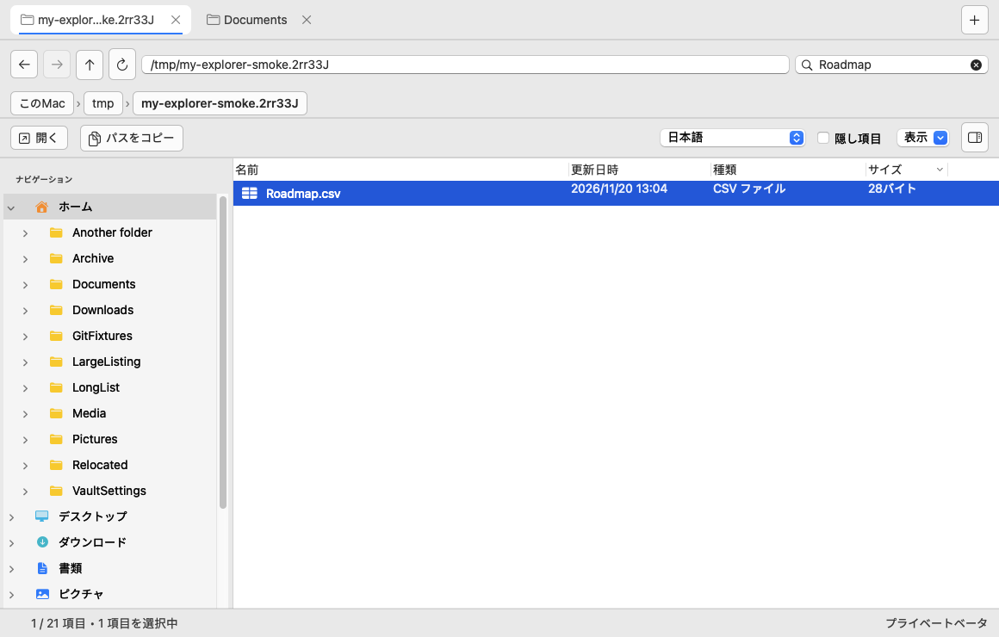
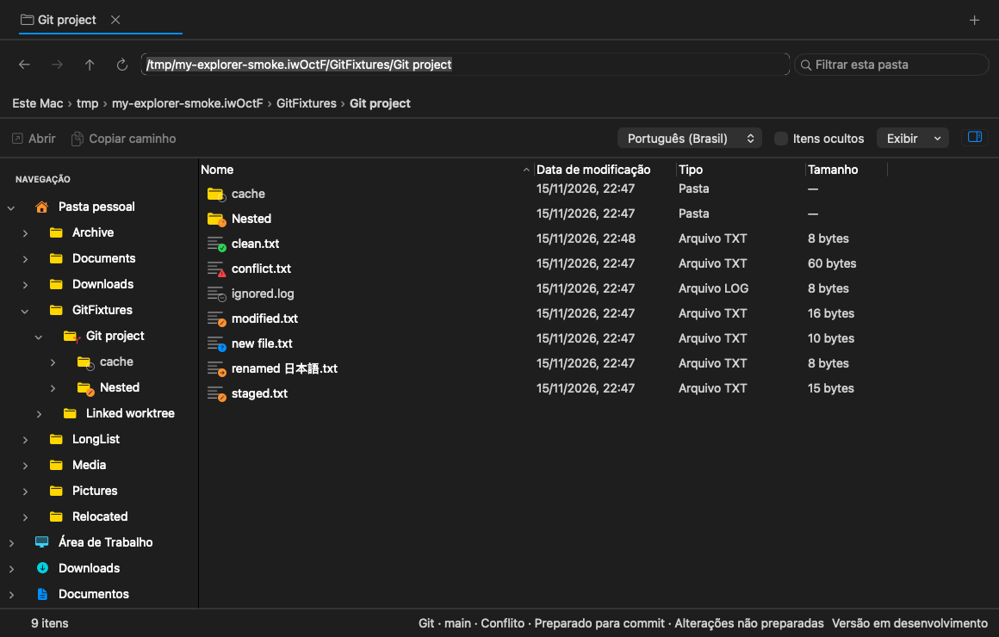

# My Explorer

[English](README.md) · [Português (Brasil)](README.pt-BR.md) · [Español](README.es.md) · [Français](README.fr.md) · [Deutsch](README.de.md) · [日本語](README.ja.md) · [한국어](README.ko.md) · [Italiano](README.it.md)

My Explorer は macOS 用のネイティブファイルマネージャーです。Windows のエクスプローラーでおなじみのフォルダーツリー、タブ、詳細表示を使いながら、Mac のボリューム、ごみ箱、関連付けられたアプリを利用できます。



## 署名済みアプリのインストール

プレリリースの DMG を開き、**My Explorer** を「アプリケーション」にコピーしてから、ディスクイメージを取り出し、アプリを開きます。ビルド 25 は Apple Development で署名済みですが、公証されていません。 [GitHub Releases](https://github.com/leoars/my-explorer/releases/tag/v0.1.0-private-beta.10-build25)

## ビルドとインストール

macOS 14 以降と Swift 6 対応の Xcode が必要です。ターミナルで `Package.swift` があるフォルダーに移動し、次のコマンドを実行します。Apple Silicon と Intel の両方に対応する場合は、ビルドコマンドの先頭に `MY_EXPLORER_ARCHITECTURES='arm64 x86_64'` を付けます。

```sh
bash scripts/build-app.sh release
open "dist/My Explorer.app"
```

インストールするにはアプリを終了し、`dist/My Explorer.app` を「アプリケーション」にコピーします。`Package.swift` は Xcode でも開けます。ローカルビルドでは既定でアドホック署名を使います。

## ファイルの閲覧と整理

ツリーでボリュームを選ぶか、アドレスバーにパスを入力します。履歴、並べ替え、選択状態はタブごとに保持されます。フィルターは現在のフォルダーの名前を対象とします。列見出しをドラッグすると、列の順序や幅を変更できます。

ファイルやフォルダーはコピー、切り取り、貼り付けができます。同名の項目がある場合は、置換、両方を保持、スキップから選びます。セッション中に行ったローカルでのコピーと移動は、最大20件まで取り消せます。コンテキストメニューから名前の変更、共有、ZIP の作成と展開もできます。

ファイルを右クリックして「プロパティ」を選ぶと詳細が表示されます。ツリーで Macintosh HD などのボリュームに対して実行すると、総容量、使用済み容量、空き容量を確認できます。

一覧で項目を選び、少し間を置いて名前をもう一度クリックすると、その場で編集できます。Enter で確定し、Esc で取り消します。ダブルクリックすると項目が開きます。F2 キーと名前変更メニューではダイアログが開きます。

現在のセッションでは Ctrl+Z または ⌘Z で、ごみ箱から元のフォルダーに項目を戻せます。同名の項目がある場合は、キャンセルして後で再試行するか、番号付きの名前で両方を保持できます。

## Git を使う

ローカルリポジトリでは変更、新規、無視対象、競合をバッジで識別できます。フォルダーや選択したファイルの「Git」メニューから、ステージ済みの変更と作業ツリーの変更を個別に確認できます。



選択した項目の履歴表示、ステージへの追加、ステージからの取り消しができます。コミットの対象はインデックス全体です。ブランチの切り替えや fetch、pull、push は Mac にインストールされた Git を使用し、ターミナルで実行を確認します。

## プレビューと文字認識

プレビューペインを有効にしてローカルファイルを選ぶと、一覧の横に内容が表示されます。画像、音声、動画はビューアーで開き、矢印キーで前後の項目に移動できます。OCR では画像やスキャンから文字を抽出し、検索可能な PDF を作成できます。


## フォルダーの保護とクラウドストレージ

ローカルフォルダーのメニューで保護を選び、初回はマスターパスワードを作成してからフォルダー用のパスワードを設定します。バックアップするときはロックし、`.myexplorervault` パッケージ全体をコピーします。ロック解除中は同じアクセス権を持つ他のアプリからもファイルを開けます。

クラウド接続では S3 バケット、Azure Blob コンテナー、Google Cloud Storage バケットを設定できます。資格情報は macOS キーチェーンに保存され、Mac とクラウドの間でコピーできます。Azure と Google Cloud は試験的な機能で、模擬サービスを使ってテストしています。

## オプションとアップデート

⌘ , でオプションを開き、起動時にタブまたは最後のフォルダーを復元できます。削除前の確認は既定で有効です。無効にすると Del でローカルの選択項目が直接ごみ箱に移動します。クラウドで削除するとリモートのオブジェクトが削除されます。

オプションで起動時のアップデート確認を有効にできます。更新がある場合は、今すぐ更新する、7日後に通知する、このバージョンをスキップする、のいずれかを選べます。**今すぐ確認**では、延期またはスキップしたバージョンも確認できます。ダウンロードは確認後に開始します。

## キーボードショートカット

| ⌨ | キーボードショートカット |
| --- | --- |
| ⌘ L | アドレスを編集 |
| ⌘ T / ⌘ W | タブを開く・閉じる |
| ⌃ Tab / ⌃ ⇧ Tab | 次・前のタブへ移動 |
| ⌘ F / F3 | 現在のフォルダーを絞り込む |
| F2 | 選択項目の名前を変更 |
| Del / Fn + ⌫ | 選択項目を削除 |
| ⌘ Z / Ctrl+Z | ローカルのファイル操作を取り消す |

## ローカルでの自動化

CLI または MCP クライアントを使うには、表示メニューから AI アクセスを開き、自動化を有効にして対象フォルダーと必要な操作を許可します。許可の有効期限は24時間です。アプリを起動した状態で、生成された `mcp.json` の設定をクライアントに読み込んでください。

## テストと不具合報告

Swift のテストを実行し、画面のロックを解除したグラフィカルセッションで UI テストを実行します。不具合を報告するときは、macOS のバージョン、Mac のアーキテクチャ、再現手順、期待した結果を記載し、サンプルファイルを使用してください。

```sh
swift test
bash scripts/smoke-test.sh
```

[Apache License 2.0](LICENSE) に基づいて配布します。同梱ライブラリの情報は[サードパーティーの通知](THIRD_PARTY_NOTICES.md)をご覧ください。
