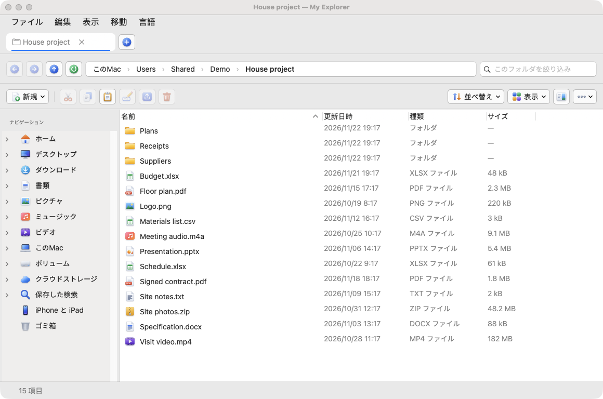

# My Explorer

[English](README.md) · [Português (Brasil)](README.pt-BR.md) · [Español](README.es.md) · [Français](README.fr.md) · [Deutsch](README.de.md) · [日本語](README.ja.md) · [한국어](README.ko.md) · [Italiano](README.it.md)

**My スイート:** **My Explorer** · [My Notepad](https://github.com/leoars/My-Notepad/blob/main/docs/readme/ja.md) · [My Paint](https://github.com/leoars/my-paint/blob/main/docs/readme/ja.md)

My Explorer は macOS 用のネイティブファイルマネージャーです。フォルダツリー、タブ、コマンドバー、複数の表示モードを、Mac のゴミ箱、ボリューム、iCloud、アプリと組み合わせて使えます。


## インストール

DMG を開き、**My Explorer** を「**アプリケーション**」にコピーします。ディスクイメージを取り出してから、アプリを開きます。公開されているバージョンは Developer ID で署名され、Apple の公証を受けています。 [Mac 版をダウンロード](https://github.com/leoars/my-explorer/releases/latest)

macOS 14 以降が必要で、Apple Silicon と Intel のどちらにも対応しています。以前のバージョンからアップデートする場合、プライバシーのアクセス許可と、アプリがキーチェーンに保存したパスワードへのアクセスを、macOS があらためて求めることがあります。

My Explorer、My Notepad、My Paint をまとめてインストールするには、[My スイートのインストーラ](https://github.com/leoars/my-suite/blob/main/docs/readme/en.md)を使ってください。

## 機能

### ナビゲーション

- フォルダツリーには、ホーム、デスクトップ、書類、ダウンロード、ピクチャ、ミュージック、ビデオ、このMac、ボリューム、クラウドストレージ、保存した検索、iPhone と iPad、ゴミ箱が並びます。
- タブごとに、履歴、選択、並べ替え、フィルタを保持します。新しいタブのボタンは最後のタブのすぐ隣にあります。
- アドレスバーは 1 つだけです。クリックできるフォルダの階層を表示し、バーをクリックするとテキストのパスに切り替わり、入力中に候補を表示します。
- **戻る**、**進む**、**親フォルダへ**、**更新**。アプリの外でファイルが変更されると、一覧は自動的に更新されます。
- **このフォルダを絞り込み**で名前による絞り込み、**ファイルを検索…**で名前、拡張子、内容、日付、タグによる検索ができます。検索範囲はこのフォルダまたは Mac 全体から選べ、検索はツリーに保存できます。
- macOS のメニューバーに加えて、ウィンドウ内にもメニュー（My Explorer、ファイル、編集、表示、移動、ウインドウ、ヘルプ）があります。

### 表示と並べ替え

- 表示モードは **詳細**、**一覧**、**小アイコン**、**大アイコン**、**ギャラリー** の 5 種類で、フォルダごとに記憶されます。
- 大アイコンとギャラリーでは、写真とビデオがサムネイルで表示されます。
- **並べ替え**は名前、更新日時、種類、サイズを基準に、昇順または降順で行えます。
- 詳細では、列見出しをドラッグして列の順序や幅を変更できます。
- 「表示」メニューに **隠し項目** と **ファイル名拡張子** があります。



### ファイル操作

- コマンドバーに **新規**、**切り取り**、**コピー**、**貼り付け**、**名前の変更**、**共有**、**削除** があります。
- コピーと移動では、進行状況の表示、一時停止、検証ができます。同じ名前がすでにある場合は、置き換える、フォルダを統合する、両方を残す、スキップするから選べます。
- **取り消す**で、セッション中のコピー、移動、削除を 20 件まで取り消せます。
- F2 キー、または名前をゆっくりもう一度クリックすると、その場で名前を変更できます。
- ツリーにゴミ箱があり、**元に戻す**、**完全に削除…**、**ゴミ箱を空にする…** を使えます。
- **ZIP に圧縮** と **ZIP を展開**。
- アプリ内でも、ほかのアプリとの間でも、ドラッグ＆ドロップができます。
- **プロパティ**でパスとアクセス権を確認できます。ボリュームでは、総容量、使用済み容量、空き容量を表示します。
- **アプリケーションで開く…**、**共有…**（AirDrop を含む）、**Finderタグを編集…**、**パスをコピー**。
- 画像と PDF のクイックアクション：回転、JPEG または PNG への変換、PDF の作成。

### プレビューウィンドウとメディアビューア

- プレビューウィンドウは、画像、再生コントロール付きのビデオとオーディオ、ページをめくれる PDF を表示し、そのほかの種類はクイックルックで表示します。
- ビューアは画像、ビデオ、オーディオを専用のウィンドウで開きます。矢印キーでフォルダ内のファイルを順に切り替えられ、1% から 800% まで拡大・縮小できます。
- アニメーション画像（WebP、GIF、APNG）は再生されます。
- ビデオの自動再生はオプションでオフにできます。

### テキスト認識（OCR）

- **テキストを抽出…** は、画像やスキャンした PDF から言語を自動判別してテキストを抽出し、コピーしたり TXT として保存したりできます。
- **検索可能な PDF を作成…** は、1 ファイルずつ、または最大 50 ファイルまで一括で実行できます。
- 処理はすべて Mac 上で行われます。

### iCloud

- iCloud Drive の各項目の状態を一覧に表示します：Mac 上にある、オンラインのみ、ダウンロード中、アップロード中。
- ファイルは 1 回のクリックでダウンロードでき、進行状況がアイコンに表示されます。**この Mac からダウンロードを削除** も使えます。
- フォルダ全体、または選択した項目だけをダウンロードできます。ファイルが多い場合は確認を求め、確保しておくディスクの空き容量を割り込むことはありません。

### クラウドストレージ

- Amazon S3：バケットへの接続、閲覧、Mac とクラウドの間のコピー、移動、フォルダの作成、削除ができます。認証情報は macOS のキーチェーンに保存されます。
- Azure Blob Storage と Google Cloud Storage は試験的な機能です。

### 保護されたフォルダ

- **フォルダを保護…** は、AES-256 で暗号化され、パスワードで開く保管庫にフォルダを収めます。
- セッションのロック時、スリープ時、終了時に自動でロックされます。

### Git

- ローカルリポジトリのファイルに状態を示すマークを付け、ステータスバーにブランチを表示します。
- **変更を表示** と **履歴を表示**、ファイルのステージとその解除、コミット、ブランチの切り替え、フェッチ、プル、プッシュができます。Mac にインストールされている Git を使います。

### ボリュームとネットワーク

- ディスクの取り出し、SMB での **サーバに接続…**、iPhone や iPad からの写真の読み込みができます。

### オプションと外観

- 起動時にタブまたは最後のフォルダを復元する、削除の前に確認する、開いているフォルダまでツリーを展開する、インターフェイスの言語を選ぶ、といった設定があります。
- フォントサイズは、ツリー、一覧、メニュー、バーごとに設定できます。テーマはシステムに合わせてライトまたはダークになります。
- アップデート：起動時に新しいバージョンを確認し、承認したバージョンをインストールできます。
- ポルトガル語、英語、スペイン語、フランス語、ドイツ語、日本語、韓国語、イタリア語に対応し、言語はすぐに切り替わります。

### 自動化

- コマンドラインと MCP サーバにより、許可したフォルダの中で AI アシスタントが 24 時間作業できます。試験的な機能で、既定ではオフです：**オプション → 連携 → AI アシスタントを接続**。

## ショートカット

Ctrl を使うショートカットは、テキストフィールドの中も含めて、おなじみのとおりに動作します。⌘ を使う同等のショートカットも使えます。

| キー | 操作 |
| --- | --- |
| Ctrl+T / Ctrl+W | タブを開く、または閉じる |
| Ctrl+Tab / Ctrl+Shift+Tab | 次のタブ、または前のタブ |
| Ctrl+L | アドレスを編集 |
| Ctrl+F / F3 | 現在のフォルダを絞り込む |
| ⇧⌘F | ファイルを検索 |
| Ctrl+X / Ctrl+C / Ctrl+V | 切り取り、コピー、貼り付け |
| Ctrl+Z | 直前の操作を取り消す |
| Ctrl+A | すべてを選択 |
| F2 | 名前の変更 |
| Del (Fn+⌫) | 選択した項目を削除 |
| Enter / Backspace | 項目を開く、または戻る |
| Option+← / → / ↑ | 戻る、進む、親フォルダへ |
| F5 / Ctrl+R | 更新 |
| Ctrl+Shift+N | 新しいフォルダー |
| Option+Enter | プロパティ |
| Ctrl++ / Ctrl+- | フォントを大きく、または小さくする |
| ⌘ , | オプション |

## My スイートの一部

My Explorer は My スイートの一部です。My スイートは、おなじみのメニューとショートカットを備えた、シンプルでわかりやすい macOS 用の 3 つのアプリです。

- **My Explorer**（このリポジトリ）：ファイルマネージャー。
- **[My Notepad](https://github.com/leoars/My-Notepad/blob/main/docs/readme/ja.md)**：シンプルなテキストエディタ。インストールしておくと、.txt ファイルをダブルクリックしたときにテキストが My Notepad で開き、コンテキストメニューに **My Notepad で編集** が加わります。
- **[My Paint](https://github.com/leoars/my-paint/blob/main/docs/readme/ja.md)**：シンプルな画像エディタ。インストールしておくと、画像のコンテキストメニューに **My Paint で編集** が加わります。

## ソースコードからインストール

macOS 14 以降の Mac と、Swift 6 対応の Xcode が必要です。`Package.swift` があるフォルダでターミナルを開き、次の 2 つのコマンドを実行します。Apple Silicon と Intel に対応するユニバーサルアプリを作る場合は、ビルドコマンドの前に `MY_EXPLORER_ARCHITECTURES='arm64 x86_64'` を設定します。

```sh
bash scripts/build-app.sh release
open "dist/My Explorer.app"
```

インストールするにはアプリを終了し、`dist/My Explorer.app` を「アプリケーション」にコピーします。`Package.swift` は Xcode でも開けます。ローカルビルドでは既定でアドホック署名を使います。

## テストとコントリビュート

Swift のテストを実行し、ロックされていないグラフィカルセッションではインターフェイスのテストも実行します。問題を報告するときは、macOS のバージョン、Mac のアーキテクチャ、再現手順、期待される結果をお知らせください。サンプルファイルを使ってください。

```sh
swift test
bash scripts/smoke-test.sh
```

[Apache License 2.0](LICENSE) に基づいて配布します。同梱ライブラリの帰属表示は[サードパーティーの通知](THIRD_PARTY_NOTICES.md)にあります。
