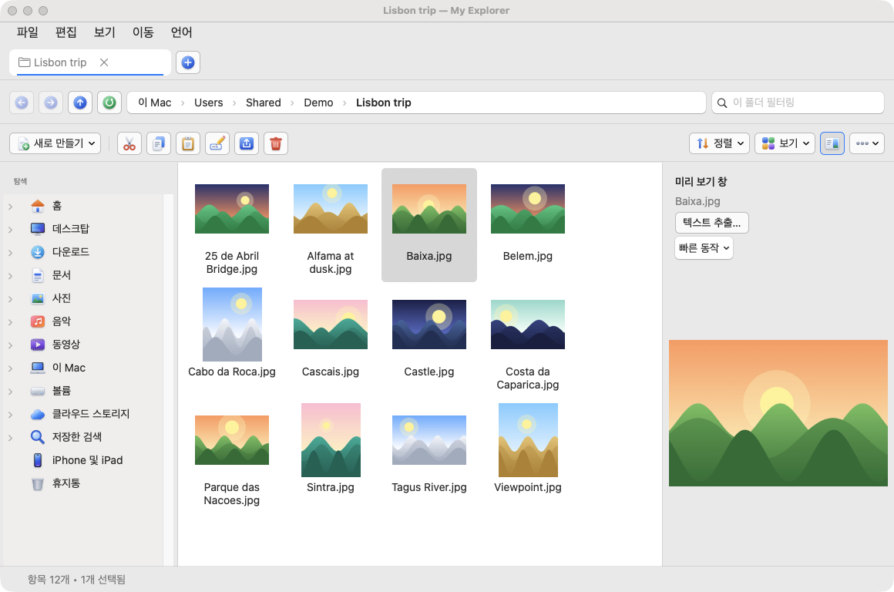
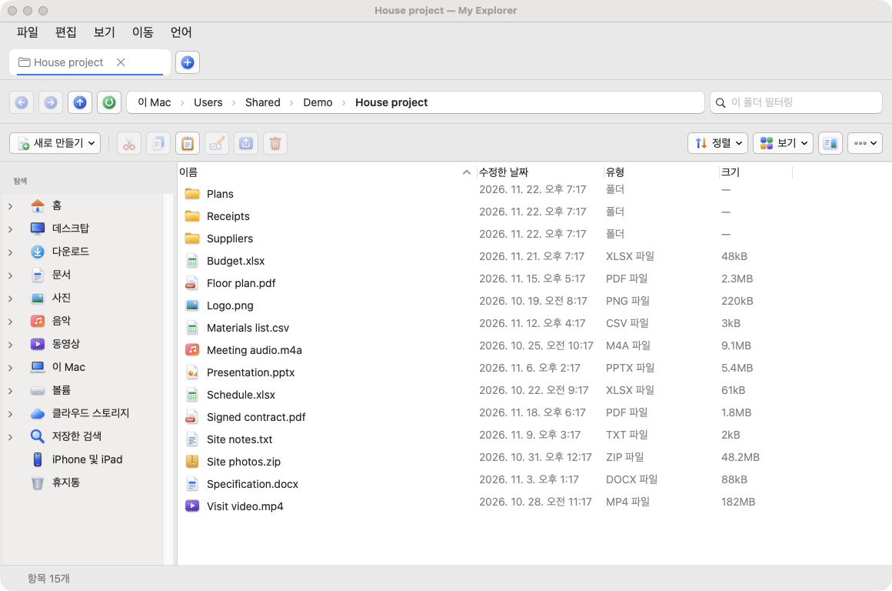

# My Explorer

[English](README.md) · [Português (Brasil)](README.pt-BR.md) · [Español](README.es.md) · [Français](README.fr.md) · [Deutsch](README.de.md) · [日本語](README.ja.md) · [한국어](README.ko.md) · [Italiano](README.it.md)

**My 스위트:** **My Explorer** · [My Notepad](https://github.com/leoars/My-Notepad/blob/main/docs/readme/ko.md) · [My Paint](https://github.com/leoars/my-paint/blob/main/docs/readme/ko.md)

My Explorer는 macOS용 네이티브 파일 관리자입니다. 폴더 트리, 탭, 명령 모음, 여러 보기 방식을 Mac의 휴지통, 볼륨, iCloud, 앱과 함께 사용할 수 있습니다.



## 설치

DMG를 열고 **My Explorer**를 **응용 프로그램** 폴더에 복사하세요. 디스크 이미지를 추출한 뒤 앱을 여세요. 공개된 버전은 Developer ID로 서명되었으며 Apple의 공증을 받았습니다. [Mac용 다운로드](https://github.com/leoars/my-explorer/releases/latest)

macOS 14 이상이 필요하며, Apple Silicon과 Intel을 모두 지원합니다. 이전 버전에서 업데이트하는 경우, macOS가 개인정보 보호 권한과 앱이 키체인에 저장한 암호에 대한 접근을 다시 요청할 수 있습니다.

My Explorer, My Notepad, My Paint를 한 번에 설치하려면 [My 스위트 설치 프로그램](https://github.com/leoars/my-suite/blob/main/docs/readme/en.md)을 사용하세요.

## 기능

### 탐색

- 폴더 트리에는 홈, 데스크탑, 문서, 다운로드, 사진, 음악, 동영상, 이 Mac, 볼륨, 클라우드 스토리지, 저장한 검색, iPhone 및 iPad, 휴지통이 있습니다.
- 탭마다 방문 기록, 선택, 정렬, 필터가 따로 유지됩니다. 새 탭 버튼은 마지막 탭 바로 뒤에 있습니다.
- 주소 표시줄은 하나뿐입니다. 클릭할 수 있는 폴더 경로를 보여 주고, 표시줄을 클릭하면 텍스트 경로로 바뀌며, 입력하는 동안 제안을 표시합니다.
- **뒤로**, **앞으로**, **상위 폴더로**, **새로 고침**. 앱 밖에서 파일이 바뀌면 목록이 자동으로 갱신됩니다.
- **이 폴더 필터링**으로 이름을 걸러 내고, **파일 검색…**으로 이름, 확장자, 내용, 날짜, 태그를 기준으로 이 폴더 또는 Mac 전체에서 검색합니다. 검색은 트리에 저장할 수 있습니다.
- macOS 메뉴 막대 외에 윈도우 안에도 메뉴(My Explorer, 파일, 편집, 보기, 이동, 윈도우, 도움말)가 있습니다.

### 보기 및 정렬

- 보기 방식은 **자세히**, **목록**, **작은 아이콘**, **큰 아이콘**, **갤러리** 다섯 가지이며, 폴더별로 기억됩니다.
- 큰 아이콘과 갤러리에서는 사진과 동영상이 축소판으로 표시됩니다.
- 이름, 수정한 날짜, 유형, 크기를 기준으로 오름차순 또는 내림차순으로 **정렬**합니다.
- 자세히에서는 열 머리글을 드래그해 열의 순서나 너비를 바꿀 수 있습니다.
- 보기 메뉴에 **숨겨진 항목**과 **파일 확장명**이 있습니다.



### 파일 작업

- 명령 모음에 **새로 만들기**, **잘라내기**, **복사**, **붙여넣기**, **이름 바꾸기**, **공유**, **삭제**가 있습니다.
- 복사와 이동은 진행률 표시, 일시 정지, 검증을 지원합니다. 같은 이름이 이미 있으면 대치, 폴더 병합, 둘 다 유지, 건너뛰기 중에서 선택합니다.
- **실행 취소**로 세션 중의 복사, 이동, 삭제를 최대 20건까지 되돌릴 수 있습니다.
- F2 키를 누르거나 이름을 천천히 한 번 더 클릭하면 그 자리에서 이름을 바꿀 수 있습니다.
- 트리에 휴지통이 있으며, **되돌려 놓기**, **영구 삭제…**, **휴지통 비우기…**를 사용할 수 있습니다.
- **ZIP으로 압축**과 **ZIP 압축 풀기**.
- 앱 안에서, 그리고 다른 앱과 서로 드래그 앤 드롭할 수 있습니다.
- **속성**에서 경로와 권한을 확인합니다. 볼륨에서는 전체 용량, 사용한 용량, 남은 용량을 표시합니다.
- **다음으로 열기…**, **공유…**(AirDrop 포함), **Finder 태그 편집…**, **경로 복사**.
- 이미지와 PDF를 위한 빠른 동작: 회전, JPEG 또는 PNG로 변환, PDF 만들기.

### 미리 보기 창과 미디어 뷰어

- 미리 보기 창은 이미지, 재생 제어기가 있는 비디오와 오디오, 페이지를 넘길 수 있는 PDF를 보여 주며, 그 밖의 유형은 훑어보기로 표시합니다.
- 뷰어는 이미지, 비디오, 오디오를 별도의 윈도우에서 열고, 화살표 키로 폴더의 파일을 차례로 넘기며, 1%에서 800%까지 확대/축소합니다.
- 움직이는 이미지(WebP, GIF, APNG)는 재생됩니다.
- 비디오 자동 재생은 옵션에서 끌 수 있습니다.

### 텍스트 인식(OCR)

- **텍스트 추출…**은 이미지와 스캔한 PDF에서 언어를 감지해 텍스트를 추출하며, 결과를 복사하거나 TXT로 저장할 수 있습니다.
- **검색 가능한 PDF 만들기…**는 파일 하나씩 또는 최대 50개까지 한꺼번에 실행할 수 있습니다.
- 모든 처리는 Mac에서 이루어집니다.

### iCloud

- iCloud Drive 각 항목의 상태를 목록에 표시합니다: Mac에 있음, 온라인 전용, 다운로드 중, 업로드 중.
- 클릭 한 번으로 파일을 다운로드하고 아이콘에서 진행률을 확인하며, **이 Mac에서 다운로드 제거**도 사용할 수 있습니다.
- 폴더 전체 또는 선택한 항목만 다운로드할 수 있습니다. 파일이 많으면 확인을 요청하며, 남겨 두기로 한 디스크 여유 공간은 절대 침범하지 않습니다.

### 클라우드 스토리지

- Amazon S3: 버킷 연결, 탐색, Mac과 클라우드 간 복사, 이동, 폴더 생성, 삭제를 지원합니다. 자격 증명은 macOS 키체인에 보관됩니다.
- Azure Blob Storage와 Google Cloud Storage는 실험적 기능입니다.

### 보호된 폴더

- **폴더 보호…**는 AES-256으로 암호화되고 암호로 여는 보관함에 폴더를 넣어 둡니다.
- 세션을 잠글 때, 잠자기에 들어갈 때, 종료할 때 자동으로 잠깁니다.

### Git

- 로컬 저장소의 파일에 상태 표시가 붙고, 상태 막대에 브랜치가 표시됩니다.
- **변경 사항 보기**와 **기록 보기**, 파일 스테이징 및 스테이징 해제, 커밋, 브랜치 전환, fetch, pull, push를 지원하며, Mac에 설치된 Git을 사용합니다.

### 볼륨과 네트워크

- 디스크 추출, SMB를 통한 **서버에 연결…**, iPhone 또는 iPad에서 사진 가져오기를 지원합니다.

### 옵션과 모양

- 열 때 탭 또는 마지막 폴더 복원, 삭제 전 확인, 열려 있는 폴더까지 트리 펼치기, 인터페이스 언어를 설정할 수 있습니다.
- 트리, 목록, 메뉴, 막대의 서체 크기를 따로 지정할 수 있습니다. 테마는 시스템에 맞춰 라이트 또는 다크로 바뀝니다.
- 업데이트: 앱을 열 때 새 버전을 확인하고, 사용자가 수락한 버전을 설치할 수 있습니다.
- 포르투갈어, 영어, 스페인어, 프랑스어, 독일어, 일본어, 한국어, 이탈리아어를 지원하며, 언어는 즉시 전환됩니다.

### 자동화

- 명령줄 도구와 MCP 서버를 통해 AI 도우미가 사용자가 허용한 폴더에서 24시간 동안 작업할 수 있습니다. 실험적 기능이며 기본적으로 꺼져 있습니다: **옵션 → 연동 → AI 도우미 연결**.

## 단축키

Ctrl 단축키는 텍스트 필드를 포함해 이미 익숙한 방식 그대로 동작하며, 이에 대응하는 ⌘ 단축키도 사용할 수 있습니다.

| 키 | 동작 |
| --- | --- |
| Ctrl+T / Ctrl+W | 탭 열기 또는 닫기 |
| Ctrl+Tab / Ctrl+Shift+Tab | 다음 탭 또는 이전 탭 |
| Ctrl+L | 주소 편집 |
| Ctrl+F / F3 | 현재 폴더 필터링 |
| ⇧⌘F | 파일 검색 |
| Ctrl+X / Ctrl+C / Ctrl+V | 잘라내기, 복사, 붙여넣기 |
| Ctrl+Z | 마지막 작업 실행 취소 |
| Ctrl+A | 모두 선택 |
| F2 | 이름 바꾸기 |
| Del (Fn+⌫) | 선택 항목 삭제 |
| Enter / Backspace | 항목 열기 또는 뒤로 가기 |
| Option+← / → / ↑ | 뒤로, 앞으로 또는 상위 폴더로 |
| F5 / Ctrl+R | 새로 고침 |
| Ctrl+Shift+N | 새 폴더 |
| Option+Enter | 속성 |
| Ctrl++ / Ctrl+- | 서체 크게 또는 작게 |
| ⌘ , | 옵션 |

## My 제품군의 일부

My Explorer는 My 제품군에 속합니다. My 제품군은 익숙한 메뉴와 단축키를 갖춘, 단순하고 간결한 macOS용 앱 세 가지입니다.

- **My Explorer**(이 저장소): 파일 관리자.
- **[My Notepad](https://github.com/leoars/My-Notepad/blob/main/docs/readme/ko.md)**: 간단한 텍스트 편집기. 설치되어 있으면 .txt 파일을 두 번 클릭할 때 텍스트가 My Notepad에서 열리고, 컨텍스트 메뉴에 **My Notepad로 편집**이 추가됩니다.
- **[My Paint](https://github.com/leoars/my-paint/blob/main/docs/readme/ko.md)**: 간단한 이미지 편집기. 설치되어 있으면 이미지의 컨텍스트 메뉴에 **My Paint로 편집**이 추가됩니다.

## 소스 코드에서 설치

macOS 14 이상이 설치된 Mac과 Swift 6을 지원하는 Xcode가 필요합니다. `Package.swift`가 있는 폴더에서 터미널을 열고 아래의 두 명령을 실행하세요. Apple Silicon과 Intel용 유니버설 앱을 만들려면 빌드 명령 앞에 `MY_EXPLORER_ARCHITECTURES='arm64 x86_64'`를 설정하세요.

```sh
bash scripts/build-app.sh release
open "dist/My Explorer.app"
```

설치하려면 앱을 종료하고 `dist/My Explorer.app`을 응용 프로그램 폴더로 복사하세요. Xcode에서 `Package.swift`를 열 수도 있습니다. 로컬 빌드는 기본적으로 임시(ad hoc) 서명을 사용합니다.

## 테스트 및 기여

Swift 테스트를 실행하고, 잠금 해제된 그래픽 세션에서는 인터페이스 테스트도 실행하세요. 문제를 보고할 때는 macOS 버전, Mac 아키텍처, 재현 단계, 예상 결과를 알려 주세요. 예제 파일을 사용하세요.

```sh
swift test
bash scripts/smoke-test.sh
```

[Apache License 2.0](LICENSE)에 따라 배포합니다. 포함된 라이브러리의 저작자 표시는 [제3자 고지](THIRD_PARTY_NOTICES.md)에 있습니다.
