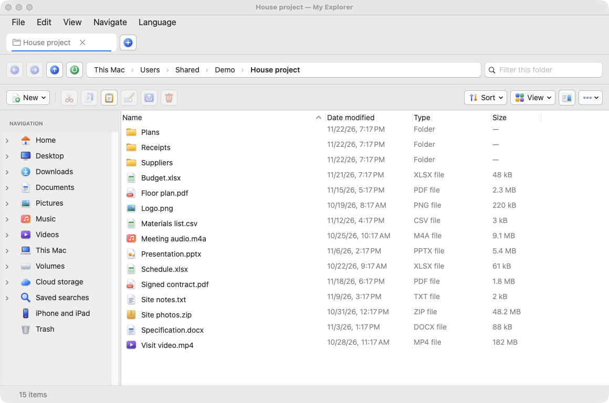

# My Explorer

[English](README.md) · [Português (Brasil)](README.pt-BR.md) · [Español](README.es.md) · [Français](README.fr.md) · [Deutsch](README.de.md) · [日本語](README.ja.md) · [한국어](README.ko.md) · [Italiano](README.it.md)

**My suite:** **My Explorer** · [My Notepad](https://github.com/leoars/My-Notepad/blob/main/docs/readme/en.md) · [My Paint](https://github.com/leoars/my-paint/blob/main/docs/readme/en.md)

My Explorer is a native file manager for macOS. It brings together a folder tree, tabs, a command bar and several view modes with the Trash, volumes, iCloud and the Mac's applications.


## Install

Open the DMG, copy **My Explorer** to **Applications**, eject the disk image and open the app. Published releases are signed with Developer ID and notarized by Apple. [Download for Mac](https://github.com/leoars/my-explorer/releases/latest)

Requires macOS 14 or later, on Apple Silicon or Intel. If you are updating from an earlier version, macOS may ask again for privacy permissions and for access to the passwords the app saved in Keychain.

## Features

### Navigation

- Folder tree with Home, Desktop, Documents, Downloads, Pictures, Music, Videos, This Mac, Volumes, Cloud storage, Saved searches, iPhone and iPad, and Trash.
- Tabs, each with its own history, selection, sorting and filter. The new tab button sits right after the last tab.
- A single address bar: it shows the clickable folder trail and turns into the path as text when you click it, with suggestions as you type.
- **Back**, **Forward**, **Up** and **Refresh**. The list refreshes by itself when files change outside the app.
- **Filter this folder** by name, and **Search Files…** by name, extension, content, date and tags, in this folder or across the whole Mac. Searches can be saved to the tree.
- Menus inside the window (File, Edit, View, Navigate, Language), in addition to the macOS menu bar.

### Views and sorting

- Five modes, remembered per folder: **Details**, **List**, **Small icons**, **Large icons** and **Gallery**.
- In Large icons and Gallery, photos and videos appear as thumbnails.
- **Sort** by name, date modified, type or size, in ascending or descending order.
- In Details, drag the headers to change the order or width of the columns.
- **Hidden items** and **File name extensions** in the View menu.



### File operations

- Command bar with **New**, **Cut**, **Copy**, **Paste**, **Rename**, **Share** and **Delete**.
- Copy and move with progress, pause and verification. If the name already exists: replace, merge folders, keep both or skip.
- **Undo** for up to 20 copies, moves and deletions in the session.
- Rename in place with F2 or with a slow second click on the name.
- Trash in the tree, with **Put Back**, **Delete Permanently…** and **Empty Trash…**.
- **Compress to ZIP** and **Extract ZIP**.
- Drag and drop inside the app, to other apps and from them.
- **Properties** with path and permissions; on a volume, total, used and free capacity.
- **Open with…**, **Share…** (including AirDrop), **Edit Finder tags…** and **Copy path**.
- Quick actions for images and PDFs: rotate, convert to JPEG or PNG, and create a PDF.

### Preview pane and media viewer

- The preview pane shows images, video and audio with playback controls, PDFs with page navigation, and other types through Quick Look.
- The viewer opens images, videos and audio in a window of its own, moves through the folder's files with the arrow keys and zooms from 1% to 800%.
- Animated images (WebP, GIF, APNG) play.
- Automatic video playback can be turned off in Options.

### Text recognition (OCR)

- **Extract text…** from images and scanned PDFs, with language detection, to copy or save as TXT.
- **Create searchable PDF…**, one file at a time or in batches of up to 50.
- Everything is done on the Mac itself.

### iCloud

- The state of each iCloud Drive item in the list: on the Mac, online only, downloading or uploading.
- Download a file with one click, with progress on the icon, and **Remove download from this Mac**.
- Download everything in a folder or just the selection, with confirmation for many files and a disk space reserve that is never exceeded.

### Cloud storage

- Amazon S3: connect a bucket, browse, copy between the Mac and the cloud, move, create folders and delete. Credentials are kept in the macOS Keychain.
- Azure Blob Storage and Google Cloud Storage are experimental.

### Protected folders

- **Protect folder…** keeps a folder in a vault encrypted with AES-256 and opened with a password.
- Automatic locking when the session is locked, when the Mac sleeps and on quit.

### Git

- State badges on the files of a local repository and the branch in the status bar.
- **View changes** and **View history**, stage and unstage files, commit, switch branches, fetch, pull and push, using the Git installed on the Mac.

### Volumes and network

- Eject disks, **Connect to server…** over SMB and import photos from an iPhone or iPad.

### Options and appearance

- Restore the tabs or the last folder at launch, confirm deletions, expand the tree to the open folder, and interface language.
- Separate font sizes for the tree, the list, the menus and the bars. Light or dark theme, following the system.
- Updates: the app can check for new versions at launch and install the one you accept.
- Available in Portuguese, English, Spanish, French, German, Japanese, Korean and Italian, switching instantly.

### Automation

- A command line tool and an MCP server let an AI assistant work in folders you authorize, for 24 hours. Experimental and off by default: **Options → Integrations → Connect an AI assistant**.

## Shortcuts

The Ctrl shortcuts work the way you already know, including in text fields; so do their ⌘ equivalents.

| Keys | Action |
| --- | --- |
| Ctrl+T / Ctrl+W | Open or close a tab |
| Ctrl+Tab / Ctrl+Shift+Tab | Next or previous tab |
| Ctrl+L | Edit the address |
| Ctrl+F / F3 | Filter the current folder |
| ⇧⌘F | Search files |
| Ctrl+X / Ctrl+C / Ctrl+V | Cut, copy and paste |
| Ctrl+Z | Undo the last operation |
| Ctrl+A | Select all |
| F2 | Rename |
| Del (Fn+⌫) | Delete the selection |
| Enter / Backspace | Open the item or go back |
| Option+← / → / ↑ | Back, forward or up |
| F5 / Ctrl+R | Refresh |
| Ctrl+Shift+N | New folder |
| Option+Enter | Properties |
| Ctrl++ / Ctrl+- | Increase or decrease font sizes |
| ⌘ , | Options |

## Part of the My suite

My Explorer is part of the My suite: three simple, straightforward applications for macOS, with the menus and shortcuts you already know.

- **My Explorer** (this repository): file manager.
- **[My Notepad](https://github.com/leoars/My-Notepad/blob/main/docs/readme/en.md)**: a simple text editor. With it installed, double-clicking a .txt file opens the text in My Notepad, and the context menu gains **Edit with My Notepad**.
- **[My Paint](https://github.com/leoars/my-paint/blob/main/docs/readme/en.md)**: a simple image editor. With it installed, the context menu for images gains **Edit with My Paint**.

## Install from source

You need a Mac with macOS 14 or later and Xcode with Swift 6. Open Terminal in the folder containing `Package.swift` and run the two commands below. To produce a universal app for Apple Silicon and Intel, set `MY_EXPLORER_ARCHITECTURES='arm64 x86_64'` before the build command.

```sh
bash scripts/build-app.sh release
open "dist/My Explorer.app"
```

To install, quit the app and copy `dist/My Explorer.app` into Applications. You can also open `Package.swift` in Xcode. Local builds use ad hoc signing by default.

## Test and contribute

Run the Swift tests and, in an unlocked graphical session, the interface tests. To report a problem, include your macOS version, Mac architecture, steps to reproduce and the expected result. Use sample files.

```sh
swift test
bash scripts/smoke-test.sh
```

Distributed under the [Apache 2.0 license](LICENSE). Attributions for the bundled libraries are in the [third-party notices](THIRD_PARTY_NOTICES.md).
