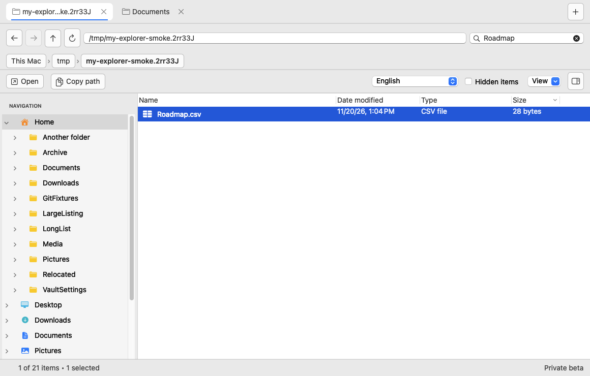

# My Explorer

[English](README.md) · [Português (Brasil)](README.pt-BR.md) · [Español](README.es.md) · [Français](README.fr.md) · [Deutsch](README.de.md) · [日本語](README.ja.md) · [한국어](README.ko.md) · [Italiano](README.it.md)

My Explorer is a native macOS file manager. Its folder tree, tabs and Details view bring familiar Windows File Explorer navigation to the Mac, alongside macOS volumes, Trash and application associations.



## Install the signed app

Open the prerelease DMG, copy **My Explorer** to **Applications**, eject the image and open the app. Version 26 is Apple Development signed and has not been notarized. [GitHub Releases](https://github.com/leoars/my-explorer/releases/tag/v0.1.0-private-beta.11-build26)

## Build and install

Use macOS 14 or later and Xcode with a Swift 6 toolchain. Open Terminal in the folder containing `Package.swift` and run the commands below. For a universal Apple Silicon and Intel build, set `MY_EXPLORER_ARCHITECTURES='arm64 x86_64'` for the build command.

```sh
bash scripts/build-app.sh release
open "dist/My Explorer.app"
```

To install, quit the app and copy `dist/My Explorer.app` into Applications. You can also open `Package.swift` in Xcode. Local builds use ad hoc signing by default.

## Browse and manage files

Select a volume in the tree or enter a path in the address bar. Each tab keeps its own history, sorting and selection. The filter matches names in the current folder. Drag column headers to rearrange or resize them.

Copy, cut and paste files or folders. When names collide, replace, keep both or skip the item. Undo covers up to 20 local copy or move operations in the current session. Use the context menu to rename, share, create ZIP archives or extract them.

Right-click a file and choose **Properties** to inspect its details. On a volume such as Macintosh HD, the same command in the tree shows total capacity, used space and free space.

To rename in place, select the item, pause, then click its name again. Enter confirms and Esc cancels. Double-click to open the item. F2 and **Rename** still open the rename dialog.

During the current session, Ctrl+Z or ⌘Z restores local items from Trash to their original folder. If the name is taken, choose Cancel to retry later or Keep Both to restore under a numbered name.

## Work with Git

In a local repository, badges identify modified, new, ignored and conflicting files. Choose **Git → View changes** on a folder or selected files to inspect staged and working-tree changes separately.


Browse the selection’s history and stage or unstage files. Commit includes the whole index. Branch switching, fetch, pull and push use the Mac’s Git installation and ask for confirmation in Terminal.

## Preview media and recognize text

Enable the preview pane and select a local file to inspect it alongside the list. Open images, audio or video in the viewer and use the arrow keys to move between items. OCR tools extract text from images and scans and can create searchable PDFs.


## Protected folders and cloud storage

Choose **Protect folder** from a local folder’s menu. On first use, create a master password and then a password for the folder. To back it up, lock it and copy the entire `.myexplorervault` package. While unlocked, its files are accessible to other applications with your permissions.

Use Cloud Connections to configure an S3 bucket, Azure Blob container or Google Cloud Storage bucket. Credentials are stored in macOS Keychain. Copy between local and cloud storage. Azure and Google Cloud have simulated-provider coverage and remain experimental.

## Preferences and updates

Open **Options** with ⌘ , to restore tabs or the last folder at launch. **Confirm before deleting files** is enabled by default. Turning it off sends local selections straight to Trash with Delete. Deleting a cloud object affects remote storage.

In **Options**, you can enable update checks at startup. When an update is available, update now, postpone for seven days or skip that version. **Check now** also checks for postponed and skipped versions. The download starts only after confirmation.

## Keyboard shortcuts

| ⌨ | Keyboard shortcuts |
| --- | --- |
| ⌘ L | Edit address |
| ⌘ T / ⌘ W | Open or close tab |
| ⌃ Tab / ⌃ ⇧ Tab | Next or previous tab |
| ⌘ F / F3 | Filter current folder |
| F2 | Rename selection |
| Del / Fn + ⌫ | Delete selection |
| ⌘ Z / Ctrl+Z | Undo local file operations |

## Local automation

To use the CLI or an MCP client, open **View → AI access**, enable automation and grant access to the folder and operations you need. The grant expires after 24 hours. Keep My Explorer open and import the generated `mcp.json` configuration into your client.

## Test and contribute

Run the Swift tests and, in an unlocked graphical session, the interface tests. For a bug report include your macOS version, Mac architecture, steps to reproduce and expected result. Use sample files.

```sh
swift test
bash scripts/smoke-test.sh
```

Distributed under the [Apache 2.0 license](LICENSE). See [third-party notices](THIRD_PARTY_NOTICES.md) for bundled libraries.
