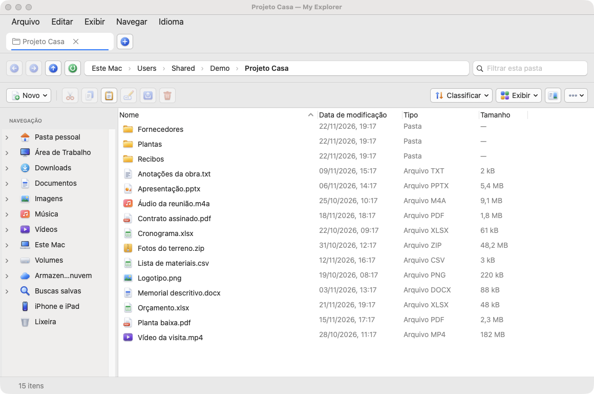

# My Explorer

[English](README.md) · [Português (Brasil)](README.pt-BR.md) · [Español](README.es.md) · [Français](README.fr.md) · [Deutsch](README.de.md) · [日本語](README.ja.md) · [한국어](README.ko.md) · [Italiano](README.it.md)

**Suíte My:** **My Explorer** · [My Notepad](https://github.com/leoars/My-Notepad) · [My Paint](https://github.com/leoars/my-paint)

My Explorer é um gerenciador de arquivos nativo para macOS. Ele reúne árvore de pastas, abas, barra de comandos e várias visualizações com a Lixeira, os volumes, o iCloud e os aplicativos do Mac.


## Instalar

Abra o DMG, copie **My Explorer** para **Aplicativos**, ejete a imagem de disco e abra o aplicativo. As versões publicadas são assinadas com Developer ID e notarizadas pela Apple. [Baixar para Mac](https://github.com/leoars/my-explorer/releases/latest)

Requer macOS 14 ou posterior, em Apple Silicon ou Intel. Se você está atualizando de uma versão anterior, o macOS pode pedir de novo as permissões de privacidade e o acesso às senhas que o aplicativo guardou nas Chaves.

Para instalar o My Explorer, o My Notepad e o My Paint de uma vez, use o [instalador da suíte My](https://github.com/leoars/my-suite).

## Funcionalidades

### Navegação

- Árvore de pastas com Pasta pessoal, Área de Trabalho, Documentos, Downloads, Imagens, Música, Vídeos, Este Mac, Volumes, Armazenamento em nuvem, Buscas salvas, iPhone e iPad e Lixeira.
- Abas, cada uma com histórico, seleção, ordenação e filtro próprios. O botão de nova aba fica logo depois da última.
- Uma barra de endereço só: mostra a trilha de pastas clicável e vira o caminho em texto quando você clica nela, com sugestões enquanto digita.
- **Voltar**, **Avançar**, **Subir** e **Atualizar**. A lista se atualiza sozinha quando os arquivos mudam por fora.
- **Filtrar esta pasta** pelo nome, e **Pesquisar arquivos…** por nome, extensão, conteúdo, data e etiquetas, nesta pasta ou no Mac inteiro. As buscas podem ser salvas na árvore.
- Menus dentro da janela (My Explorer, Arquivo, Editar, Exibir, Navegar, Janela, Ajuda), além da barra de menus do macOS.

### Visualizações e classificação

- Cinco modos, lembrados por pasta: **Detalhes**, **Lista**, **Ícones pequenos**, **Ícones grandes** e **Galeria**.
- Em Ícones grandes e na Galeria, fotos e vídeos aparecem com miniatura.
- **Classificar** por nome, data de modificação, tipo ou tamanho, em ordem crescente ou decrescente.
- Em Detalhes, arraste os cabeçalhos para mudar a ordem ou a largura das colunas.
- **Itens ocultos** e **Extensões de nomes de arquivo** no menu Exibir.



### Operações com arquivos

- Barra de comandos com **Novo**, **Recortar**, **Copiar**, **Colar**, **Renomear**, **Compartilhar** e **Excluir**.
- Copiar e mover com progresso, pausa e verificação. Se o nome já existir: substituir, mesclar pastas, manter ambos ou ignorar.
- **Desfazer** para até 20 cópias, movimentações e exclusões da sessão.
- Renomear no próprio lugar com F2 ou com um segundo clique lento no nome.
- Lixeira na árvore, com **Restaurar**, **Excluir definitivamente…** e **Esvaziar Lixeira…**.
- **Compactar para ZIP** e **Extrair ZIP**.
- Arrastar e soltar dentro do aplicativo, para outros aplicativos e a partir deles.
- **Propriedades** com caminho e permissões; em um volume, capacidade total, usada e livre.
- **Abrir com…**, **Compartilhar…** (inclusive por AirDrop), **Editar etiquetas do Finder…** e **Copiar caminho**.
- Ações rápidas para imagens e PDFs: girar, converter em JPEG ou PNG e criar PDF.

### Painel de visualização e visualizador de mídia

- O painel de visualização mostra imagens, vídeo e áudio com controles de reprodução, PDF com passagem de páginas e os demais tipos pelo Quick Look.
- Arquivos Markdown aparecem formatados no painel de visualização (títulos, listas e listas de tarefas, tabelas, código com realce de sintaxe, notas de rodapé, imagens da mesma pasta), com um botão para ver o texto original. Imagens remotas não são baixadas, e os links só abrem com um clique.
- O visualizador abre imagens, vídeos e áudios em janela própria, avança pelos arquivos da pasta com as setas e dá zoom de 1% a 800%.
- Imagens animadas (WebP, GIF, APNG) são reproduzidas.
- A reprodução automática de vídeos pode ser desligada em Opções.

### Reconhecimento de texto (OCR)

- **Extrair texto…** de imagens e PDFs digitalizados, com detecção do idioma, para copiar ou salvar como TXT.
- **Criar PDF pesquisável…**, um arquivo por vez ou em lote de até 50.
- Tudo é feito no próprio Mac.

### iCloud

- Estado de cada item do iCloud Drive na lista: no Mac, somente on-line, baixando ou enviando.
- Baixar um arquivo com um clique, com o progresso no ícone, e **Remover download deste Mac**.
- Baixar tudo de uma pasta ou só a seleção, com confirmação para muitos arquivos e uma reserva de espaço em disco que nunca é ultrapassada.

### Armazenamento em nuvem

- Amazon S3: conectar um bucket, navegar, copiar entre o Mac e a nuvem, mover, criar pastas e excluir. As credenciais ficam nas Chaves do macOS.
- Azure Blob Storage e Google Cloud Storage são experimentais.

### Pastas protegidas

- **Proteger pasta…** guarda uma pasta em um cofre cifrado com AES-256, aberto por senha.
- Bloqueio automático ao bloquear a sessão, ao dormir e ao sair.

### Git

- Marcas de estado nos arquivos de um repositório local e a branch na barra de status.
- **Ver alterações** e **Ver histórico**, preparar e retirar arquivos, commit, trocar de branch, fetch, pull e push, usando o Git instalado no Mac.

### Volumes e rede

- Ejetar discos, **Conectar ao servidor…** por SMB e importar fotos de um iPhone ou iPad.

### Opções e aparência

- Restaurar as abas ou a última pasta ao abrir, confirmar exclusões, expandir a árvore até a pasta aberta e idioma da interface.
- Tamanhos de fonte separados para a árvore, a lista, os menus e as barras. Tema claro ou escuro, seguindo o sistema.
- Atualizações: o aplicativo pode verificar novas versões ao abrir e instalar a que você aceitar.
- Disponível em português, inglês, espanhol, francês, alemão, japonês, coreano e italiano, com troca imediata.

### Automação

- Uma linha de comando e um servidor MCP permitem que um assistente de IA trabalhe em pastas que você autorizar, por 24 horas. Experimental e desligado por padrão: **Opções → Integrações → Conectar um assistente de IA**.

## Atalhos

Os atalhos com Ctrl funcionam como você já conhece, inclusive nos campos de texto; os equivalentes com ⌘ também.

| Teclas | Ação |
| --- | --- |
| Ctrl+T / Ctrl+W | Abrir ou fechar uma aba |
| Ctrl+Tab / Ctrl+Shift+Tab | Próxima aba ou aba anterior |
| Ctrl+L | Editar o endereço |
| Ctrl+F / F3 | Filtrar a pasta atual |
| ⇧⌘F | Pesquisar arquivos |
| Ctrl+X / Ctrl+C / Ctrl+V | Recortar, copiar e colar |
| Ctrl+Z | Desfazer a última operação |
| Ctrl+A | Selecionar tudo |
| F2 | Renomear |
| Del (Fn+⌫) | Excluir a seleção |
| Enter / Backspace | Abrir o item ou voltar |
| Option+← / → / ↑ | Voltar, avançar ou subir |
| F5 / Ctrl+R | Atualizar |
| Ctrl+Shift+N | Nova pasta |
| Option+Enter | Propriedades |
| Ctrl++ / Ctrl+- | Aumentar ou diminuir as fontes |
| ⌘ , | Opções |

## Parte da suíte My

O My Explorer faz parte da suíte My: três aplicativos para macOS simples e diretos, com os menus e os atalhos de sempre.

- **My Explorer** (este repositório): gerenciador de arquivos.
- **[My Notepad](https://github.com/leoars/My-Notepad)**: editor de texto simples. Com ele instalado, o duplo clique em um arquivo .txt abre o texto no My Notepad, e o menu de contexto ganha **Editar com o My Notepad**.
- **[My Paint](https://github.com/leoars/my-paint)**: editor de imagens simples. Com ele instalado, o menu de contexto das imagens ganha **Editar com o My Paint**.

## Instalar a partir do código-fonte

É preciso um Mac com macOS 14 ou posterior e Xcode com Swift 6. Abra o Terminal na pasta que contém `Package.swift` e execute os dois comandos abaixo. Para gerar um aplicativo universal para Apple Silicon e Intel, defina `MY_EXPLORER_ARCHITECTURES='arm64 x86_64'` antes do comando de build.

```sh
bash scripts/build-app.sh release
open "dist/My Explorer.app"
```

Para instalar, feche o aplicativo e copie `dist/My Explorer.app` para Aplicativos. Você também pode abrir `Package.swift` no Xcode. O build local usa assinatura ad hoc por padrão.

## Testar e contribuir

Execute os testes do Swift e, em uma sessão gráfica desbloqueada, os testes de interface. Para relatar um problema, informe o macOS, a arquitetura do Mac, as etapas de reprodução e o resultado esperado. Use arquivos de exemplo.

```sh
swift test
bash scripts/smoke-test.sh
```

Distribuído sob a [licença Apache 2.0](LICENSE). As atribuições das bibliotecas incluídas estão nos [avisos de terceiros](THIRD_PARTY_NOTICES.md).
