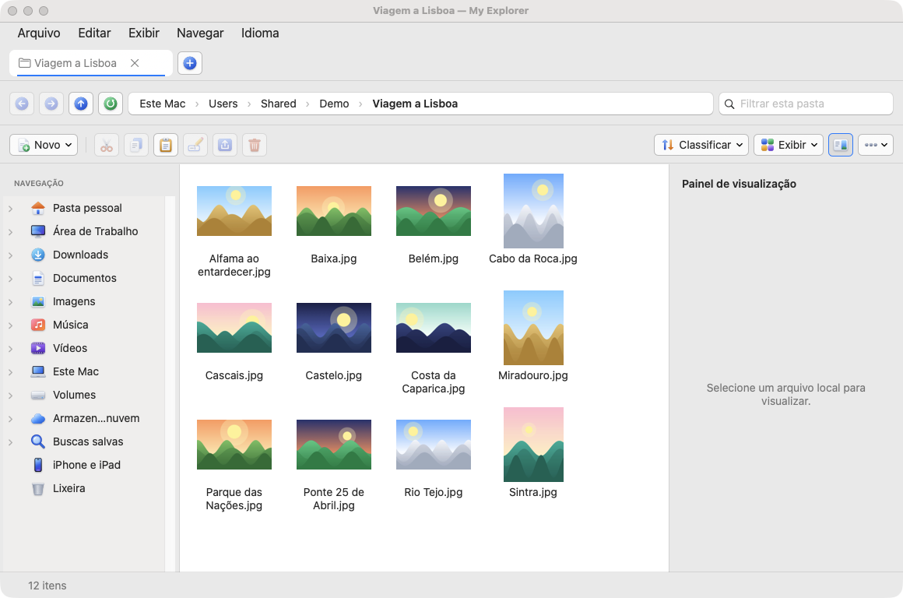

# My Explorer

[English](README.md) · [Português (Brasil)](README.pt-BR.md) · [Español](README.es.md) · [Français](README.fr.md) · [Deutsch](README.de.md) · [日本語](README.ja.md) · [한국어](README.ko.md) · [Italiano](README.it.md)

My Explorer é um gerenciador de arquivos nativo para macOS. Ele reúne a árvore de pastas, as abas e a visualização em detalhes familiares a quem usa o Explorador de Arquivos do Windows com a Lixeira, os volumes e os aplicativos do Mac.



## Instalar a versão 29

Abra o DMG, copie **My Explorer** para **Aplicativos**, ejete a imagem de disco e abra o aplicativo. Esta versão foi assinada com um certificado Apple Development e não foi notarizada pela Apple. [Baixar para Mac](https://github.com/leoars/my-explorer/releases/latest)

Na versão 29, ao arrastar arquivos sobre a árvore de pastas, uma pasta só se abre depois de o ponteiro ficar parado sobre ela por um segundo; as pastas pelo caminho continuam fechadas. Na barra de endereços, o primeiro clique seleciona o endereço inteiro, o segundo posiciona o cursor e **Esc** restaura o endereço atual. A conexão com assistentes de IA passou para **Opções → Integrações**, e o aplicativo tem um novo ícone.

## Instalar a partir do código-fonte

É preciso um Mac com macOS 14 ou posterior e Xcode com Swift 6. Abra o Terminal na pasta que contém `Package.swift` e execute os dois comandos abaixo. Para gerar um aplicativo universal para Apple Silicon e Intel, defina `MY_EXPLORER_ARCHITECTURES='arm64 x86_64'` antes do comando de build.

```sh
bash scripts/build-app.sh release
open "dist/My Explorer.app"
```

Para instalar, feche o aplicativo e copie `dist/My Explorer.app` para Aplicativos. Você também pode abrir `Package.swift` no Xcode. O build local usa assinatura ad hoc por padrão.

## Navegar e organizar arquivos

Clique na árvore para navegar pelos volumes ou digite um caminho na barra de endereço. Cada aba mantém seu próprio histórico, ordenação e seleção. O filtro pesquisa os nomes na pasta aberta. Arraste os cabeçalhos para mudar a ordem ou a largura das colunas.

Copie, recorte e cole arquivos ou pastas. Se o nome já existir, escolha substituir, manter ambos ou ignorar. Desfazer recupera até 20 operações locais de cópia ou movimentação da sessão. Use o menu de contexto para renomear, compartilhar ou criar e extrair ZIPs.

Clique com o botão direito em um arquivo e escolha **Propriedades** para consultar seus detalhes. Em um volume na árvore, como Macintosh HD, o mesmo comando mostra a capacidade total, o espaço usado e o livre.

Para renomear na lista, selecione o item, faça uma pausa e clique novamente no nome. Enter confirma e Esc cancela. O duplo clique abre o item. F2 e **Renomear** continuam abrindo o diálogo.

Na sessão atual, Ctrl+Z ou ⌘Z restaura os itens da Lixeira para a pasta de origem. Se o nome estiver ocupado, escolha Cancelar para tentar depois ou Manter ambos para restaurar com um nome numerado.

## Trabalhar com Git

Dentro de um repositório local, os símbolos identificam arquivos modificados, novos, ignorados ou em conflito. No menu **Git → Ver alterações**, confira as diferenças da pasta ou dos arquivos selecionados. As alterações preparadas para commit aparecem separadas das que ainda estão na árvore de trabalho.


Consulte o histórico da seleção e prepare ou retire arquivos do índice. O commit considera todos os arquivos preparados. Ações como trocar de branch, buscar, fazer pull ou push usam o Git instalado no Mac e pedem confirmação no Terminal.

## Visualizar arquivos e reconhecer texto

Ative o painel de visualização e selecione um arquivo local para inspecioná-lo na lista. Abra imagens, áudio ou vídeo no visualizador e avance com as setas. Para uma imagem ou PDF digitalizado, as ferramentas de OCR permitem extrair texto e criar um PDF pesquisável.


## Pastas protegidas e armazenamento em nuvem

No menu de uma pasta local, escolha **Proteger pasta**. No primeiro uso, cadastre a senha mestra e depois a senha da pasta. Para fazer backup, bloqueie a pasta e copie o pacote `.myexplorervault` inteiro. Enquanto estiver desbloqueado, outros aplicativos com as suas permissões poderão acessar os arquivos.

Em Conexões de nuvem, configure um bucket S3, um contêiner Azure Blob ou um bucket do Google Cloud Storage. As credenciais ficam nas Chaves do macOS. A cópia funciona entre o Mac e a nuvem. Azure e Google Cloud têm cobertura com provedores simulados e permanecem experimentais.

## Opções e atualizações

Abra **Opções** com ⌘ , para restaurar abas ou a última pasta na próxima abertura. A opção **Confirmar para excluir arquivos** vem marcada. Ao desmarcá-la, Del envia a seleção local diretamente para a Lixeira. Na nuvem, a exclusão afeta o objeto remoto.

Em **Opções**, o My Explorer pode verificar novas versões ao abrir. Se houver uma atualização, escolha atualizar agora, lembrar em sete dias ou pular a versão. **Verificar agora** permite consultar inclusive uma versão adiada ou pulada. O download só começa após sua confirmação.

## Atalhos

| ⌨ | Atalhos |
| --- | --- |
| ⌘ L | Editar o endereço |
| ⌘ T / ⌘ W | Abrir ou fechar uma aba |
| ⌃ Tab / ⌃ ⇧ Tab | Próxima aba ou aba anterior |
| ⌘ F / F3 | Filtrar a pasta atual |
| F2 | Renomear a seleção |
| Del / Fn + ⌫ | Excluir a seleção |
| ⌘ Z / Ctrl+Z | Desfazer operação local |

## Automação local

Para integrar a CLI ou um cliente MCP, abra **Opções → Integrações → Conectar um assistente de IA**, habilite a automação e conceda as permissões necessárias a uma pasta. A autorização expira em 24 horas. Mantenha o aplicativo aberto e importe a configuração gerada em `mcp.json` no cliente.

## Testar e contribuir

Execute os testes do Swift e, em uma sessão gráfica desbloqueada, os testes de interface. Para relatar um problema, informe o macOS, a arquitetura do Mac, as etapas de reprodução e o resultado esperado. Use arquivos de exemplo.

```sh
swift test
bash scripts/smoke-test.sh
```

Distribuído sob a [licença Apache 2.0](LICENSE). As atribuições das bibliotecas incluídas estão nos [avisos de terceiros](THIRD_PARTY_NOTICES.md).
